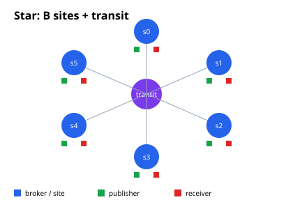
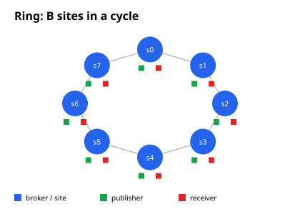
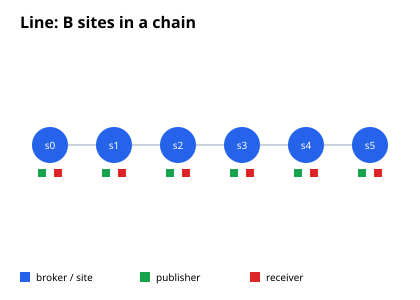
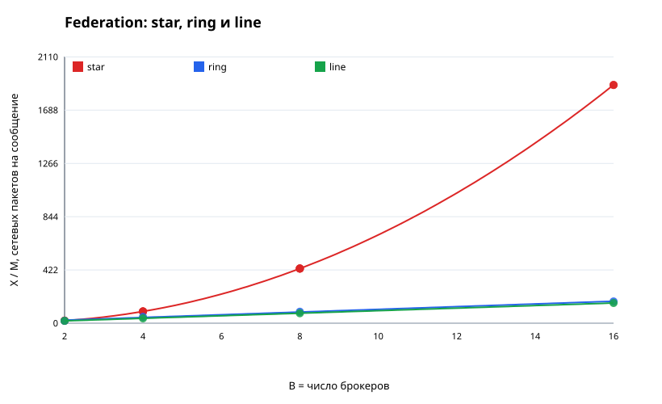
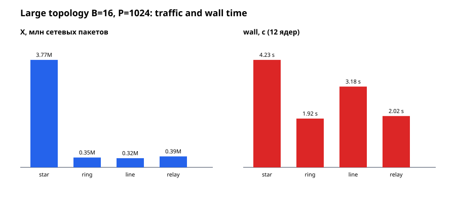

# Масштабирование числа сообщений в симуляторе MqttY: эмпирико-аналитическая модель

> Единая версия с внешней серией о доставке и стоимости пересылки —
> [super-article.md](super-article.md).

**Аннотация.** Работа исследует, как число сетевых сообщений в симуляторе
MQTT-сетей MqttY зависит от числа сетевых узлов, брокеров, клиентов и
сгенерированных публикаций. На 63 конфигурациях LoadBalancing, Relay и Federation (три топологии: star, ring, line)
показано, что число прикладных сообщений определяется нагрузкой
$M = R\,T$, доставки в LoadBalancing равны $M$, а в Relay и Federation —
$M B$. Сетевой трафик в LoadBalancing растёт линейно по длине пути
$X \approx 4M(L+1)$, в Relay — линейно по числу брокеров
$X \approx M(12.29B - 4.46)$, а в федерации — квадратично
$X \approx M(8.08B^2 - 11.99B + 11.87)$. Модели объясняют 99.7–100 %
дисперсии; корреляция $X/M$ с длиной пути составляет 0.995, с числом
брокеров — 0.998–1.000.

## 1. Введение

При проектировании симуляций и нагрузочных экспериментов важно заранее
оценивать не только число публикаций, но и объём сетевого трафика. В
MqttY одно прикладное сообщение порождает цепочку пакетов: публикацию,
подтверждения QoS, доставки подписчикам и, в федерации, пересылки между
сайтами. Число этих пакетов зависит от топологии.

Цель работы — получить проверяемые формулы

$$
  X = f(M, B, C, N, L),
$$

где $M$ — число сообщений, $B$ — брокеры, $C$ — клиенты, $N$ — сети,
$L$ — длина пути. Мы совмещаем аналитический вывод с эмпирической
регрессией на данных reference-бенчмарка.

## 1.1 Термины

- **wall time / wall-clock** — реальное время выполнения на хосте. Оно
  отличается от модельного времени (тиков симуляции) и включает планировщик,
  GC, ожидание барьеров и ввод-вывод.
- **LB (LoadBalancing)** — движок MqttY, распределяющий MQTT-подключения
  клиентов по нескольким backend-брокерам (RoundRobin, LeastConnections,
  DirectBalanced, Single).
- **Holdout** — отложенная точка, не участвовавшая в подгонке коэффициентов.
  Модель обучается на $B<16$ (или $L<4$) и проверяется на $B=16$ (или $L=4$);
  holdout-ошибка показывает обобщающую способность, а не качество подгонки.
- **$M$** — запланированные публикации, **$D$** — уникальные доставки,
  **$X$** — сетевые пакеты, **$B$** — брокеры, **$P$** — публикаторы,
  **$C$** — клиенты, **$N$** — сети, **$L$** — длина пути.

> Формулы записаны в GitHub-flavored Markdown: `$...$` и `$$...$$`.
> В просмотрщиках без MathJax используйте plain-text сводку
> [topologies-summary.md](topologies-summary.md).

## 2. Переменные и единицы

| Обозначение | Смысл | Как измеряется |
|---|---|---|
| $M$ | запланированные публикации | `scheduled` (шаг симуляции) |
| $D$ | уникальные доставки получателям | `unique` |
| $X$ | сетевые пакеты (вход/выход) | сумма счётчиков `NetworkInbound` |
| $B$ | число брокеров | параметр `--brokers` |
| $P$ | число публикующих клиентов | параметр `--publishers` |
| $C$ | всего клиентов | $P+B$ LB; $P+B^2+2B$ Fed; $P+3B^2$ Relay |
| $N$ | число сетей | $1+BL$ LB; $B+1$ Fed/Relay star |
| $L$ | число hop-сетей на backend | параметр `--nets` |
| $R$ | предложенная интенсивность, сообщений/с | `--rps` / `--fed-rps` |
| $T$ | длительность измерения, с | `--measure` |

Для LoadBalancing используется общая клиентская LAN и $B$ backend-цепочек
длины $L$, поэтому

$$
  N_{\mathrm{LB}} = 1 + B L, \qquad C_{\mathrm{LB}} = P + B.
$$

Для федерации и relay в конфигурации бенчмарка используется star-топология:
$B$ сайтов и один транзитный узел, поэтому

$$
  N_{\mathrm{Fed}} = N_{\mathrm{Relay}} = B + 1.
$$

Для федерации

$$
  C_{\mathrm{Fed}} = P + B + B(B+1) = P + B^2 + 2B.
$$

Член $B(B+1)$ — это $B$ входных listener-клиентов и $B$ выходных
клиентов на каждый сайт (соседи + self) в star-федерации.

В Relay каждый сайт запускает $3B-1$ relay-клиентов (B listen,
B relay для собственного origin и B−1 импортных), поэтому

$$
  C_{\mathrm{Relay}} = P + B + B(3B-1) = P + 3B^2.
$$

## 3. Аналитические соотношения

### 3.1 LoadBalancing

В измерении генерируется $M = RT$ публикаций. Каждая публикация
обслуживается одним брокером и доставляется одному получателю на backend,
поэтому

$$
  D_{\mathrm{LB}} = M.
$$

При QoS 1 одно сообщение порождает четыре сетевых пакета на каждом участке
пути: PUBLISH клиент→брокер, PUBACK брокер→клиент, PUBLISH брокер→получатель,
PUBACK получатель→брокер. Путь между клиентской LAN и backend-сетью содержит
$L+1$ сетей. Отсюда

$$
  X_{\mathrm{LB}} \approx 4M(L+1) + X_{\mathrm{setup}}(B,P).
$$

Член $X_{\mathrm{setup}}$ описывает connect/subscribe и не зависит от $M$.
Подстановка $L=(N-1)/B$ даёт

$$
  X_{\mathrm{LB}} \approx \frac{4M(N-1)}{B} + 4M + X_{\mathrm{setup}}.
$$

Для фиксированного $B$ трафик линеен по числу сетей $N$; для фиксированной
длины пути он не зависит от $B$, кроме малого setup-члена.

### 3.2 Federation

В star-федерации каждая публикация доставляется на все $B$ сайтов:

$$
  D_{\mathrm{Fed}} = M B.
$$

Каждый сайт пересылает сообщение остальным сайтам; при подавлении повторов
число пересылок на публикацию растёт как $B(B-1)$. Каждая пересылка
проходит через транзитную сеть, поэтому ожидается квадратичный закон

$$
  X_{\mathrm{Fed}} \approx \alpha M B^2 + \beta M B + \gamma M.
$$

В переменных топологии $B=N-1$:

$$
  X_{\mathrm{Fed}} \approx \alpha M (N-1)^2 + \beta M (N-1) + \gamma M.
$$

Это ключевое отличие: в LB сетевой трафик линеен по $N$, в федерации —
квадратичен по числу сайтов.

### 3.3 Relay

Relay доставляет каждую публикацию на все $B$ сайтов, но пересылает её
только один раз в каждый удалённый сайт, без flood-размножения:

$$
  D_{\mathrm{Relay}} = M B.
$$

На публикацию приходится $B-1$ удалённых пересылок и $B$ локальных
доставок; каждая пересылка проходит фиксированный star-путь. Поэтому
ожидается линейный закон

$$
  X_{\mathrm{Relay}} \approx \alpha M B + \beta M.
$$

В переменных топологии $B=N-1$:

$$
  X_{\mathrm{Relay}} \approx \alpha M (N-1) + \beta M.
$$

Итоговая иерархия: LB — $O(MN)$, Relay — $O(MN)$, Federation —
$O(MN^2)$.

## 4. Экспериментальный план

Стенд: Intel Xeon E5-2680 v3, 12 физических / 24 логических ядра, .NET 6,
`workers=4` (для сбора данных важны счётчики, не ускорение). Каждая точка —
один прогон `Benchmark.Compare` в parallel-режиме, `measure=1 с`,
`warmup=0.01 с`, `drain=10 с`, seed 42, QoS 1, payload 16 байт.

Варьировались:

- LB: $B\in\{2,4,8,16\}$, $P\in\{8,16,32,64\}$,
  $L\in\{1,2,4\}$, $R\in\{500,1000,2000,5000\}$;
- Federation и Relay: $B\in\{2,4,8,16\}$,
  $P\in\{8,16,32,64\}$, $R\in\{500,1000,2000,5000\}$,
  star-топология.

Факторный план — «один фактор за раз» плюс четыре комбинированные точки;
всего 63 наблюдения (19 LB, 28 Fed по трём топологиям, 16 Relay). Полные данные и скрипт:
`measurements.csv`, `run_campaign.py`, `analyze.py`.

## 5. Результаты

### 5.1 LoadBalancing

Регрессия

$$
  X = a\,M L + b\,M + c\,B + d\,P + e
$$

дала

$$
  a = 4.069,\quad b = 3.949,\quad c = 19.74,\quad d = 8.14,\quad e = -43.7,
$$
$$
  R^2 = 0.999992,\qquad \mathrm{RMSE} = 57.9\ \text{пакета}.
$$

То есть

$$
  \boxed{X_{\mathrm{LB}} \approx 4M(L+1) + 19.7B + 8.14P - 44.}
$$

Члены $19.7B$ и $8.14P$ — стоимость connect/subscribe; при больших $M$
они пренебрежимы по сравнению с $4M(L+1)$.

Нормированная модель $X/M = aL + b$:

$$
  X/M = 4.157\,L + 3.981,\qquad R^2 = 0.9972.
$$

Идеальный коэффициент 4 подтверждается с точностью 4 %. Примеры:

| $B$ | $L$ | $M$ | $X$ | $X/M$ | формула $4(L+1)$ |
|---:|---:|---:|---:|---:|---:|
| 8 | 1 | 2000 | 16 352 | 8.18 | 8 |
| 8 | 2 | 2000 | 24 528 | 12.26 | 12 |
| 8 | 4 | 2000 | 40 880 | 20.44 | 20 |
| 4 | 4 | 5000 | 101 240 | 20.25 | 20 |

Во всех LB-точках $D=M$: число доставок не зависит от $B$, $P$ и $L$.
Клиенты и брокеры влияют только на setup-член.


### 5.2 Federation

Для ненасыщенных точек ($D=MB$, 14 из 16) регрессия

$$
  X/M = \alpha B^2 + \beta B + \gamma
$$

дала

$$
  \alpha = 8.077,\quad \beta = -11.977,\quad \gamma = 11.836,
$$
$$
  R^2 = 0.9999998,\qquad \mathrm{RMSE} = 0.255\ \text{пакета/сообщение}.
$$

Итого:

$$
  \boxed{X_{\mathrm{Fed}} \approx M\left(8.077B^2 - 11.977B + 11.836\right).}
$$

Через число сетей $N=B+1$:

$$
  X_{\mathrm{Fed}} \approx M\left(8.077(N-1)^2 - 11.977(N-1) + 11.836\right).
$$

| $B$ | $N$ | $M$ | $X$ | $X/M$ | модель |
|---:|---:|---:|---:|---:|---:|
| 2 | 3 | 1000 | 20 300 | 20.30 | 20.19 |
| 4 | 5 | 1000 | 93 104 | 93.10 | 93.12 |
| 8 | 9 | 1000 | 432 776 | 432.78 | 432.83 |
| 16 | 17 | 1000 | 1 888 376 | 1888.38 | 1888.37 |


Доставки:

$$
  D_{\mathrm{Fed}} = MB
$$

выполняется точно для 14 ненасыщенных точек.


При $R=5000$ наблюдалось
насыщение: $D/(MB)=0.84$ (B=4 и B=8), что объясняется потерями/таймаутами
при перегрузке; такие точки исключены из регрессии $X/M$, но показаны в
таблице данных.

### 5.3 Relay

Для всех 16 relay-точек $D=MB$ выполнялось точно, включая $R=5000$.
Регрессия

$$
  X/M = \alpha B + \beta
$$

дала

$$
  \alpha = 12.291,\quad \beta = -4.461,
$$
$$
  R^2 = 0.99992,\qquad \mathrm{RMSE} = 0.456\ \text{пакета/сообщение}.
$$

Итого:

$$
  \boxed{X_{\mathrm{Relay}} \approx M\left(12.291B - 4.461\right).}
$$

Через число сетей $N=B+1$:

$$
  X_{\mathrm{Relay}} \approx M\left(12.291(N-1) - 4.461\right).
$$

| $B$ | $N$ | $M$ | $X$ | $X/M$ | модель |
|---:|---:|---:|---:|---:|---:|
| 2 | 3 | 1000 | 20 300 | 20.30 | 20.12 |
| 4 | 5 | 1000 | 44 690 | 44.69 | 44.70 |
| 8 | 9 | 1000 | 93 740 | 93.74 | 93.86 |
| 16 | 17 | 1000 | 192 980 | 192.98 | 192.19 |


Relay занимает промежуточное положение: доставки как в федерации
($D=MB$), но пересылки не размножаются, поэтому трафик линеен по $B$.

### 5.4 Валидация на втором (слабом) хосте

Для проверки аппаратной инвариантности модели те же конфигурации прогнаны на
слабом хосте: Intel Celeron N3350, **2 физических ядра / 2 потока**,
1.1 ГГц, 3.7 ГБ RAM, Linux, .NET 8 (roll-forward с net6). Сильный хост:
Xeon E5-2680 v3, **12 физических / 24 логических** ядра, `workers=12`.

| Конфиг | Слабый: wall / refresh | Сильный: wall / refresh | $M$ / $D$ / $X$ |
|---|---:|---:|---:|
| LB reference | 0.97× / 0.97× | 2.32× / 2.55× | 20 000 / 20 000 / 402 960 |
| LB L | 1.69× / 1.74× | 5.73× / 7.22× | 20 000 / 20 000 / 407 840 |
| Relay | 1.73× / 1.82× | 4.24× / 5.94× | 2 000 / 32 000 / 382 928–383 312 |
| Federation | 1.71× / 1.75× | 4.06× / 5.17× | 2 000 / 32 000 / 3 775 504 |

Ключевой результат: **числа сообщений и сетевых пакетов совпадают** на двух
машинах с разной архитектурой и числом ядер:

- LB L: $X=407\,840$ на обоих хостах (точно);
- Relay: $382\,928$ против $383\,312$ (расхождение 0.1 %);
- Federation: $3\,775\,504$ на обоих хостах (точно);
- $M$ и $D$ совпадают во всех конфигурациях.

Скорость же масштабируется по физическим ядрам: на 2 ядрах ускорение
~1.7×, на 12 ядрах — 4.1–5.7×. Это подтверждает, что найденные формулы
описывают **модель**, а не конкретный хост, и что аппаратная зависимость
сосредоточена в wall/refresh speedup, а не в счётчиках сообщений.


Данные: `hardware-validation.csv`.

### 5.5 Сравнение трёх топологий Federation

При фиксированных $P=32$, $R=1000$ и $M=1000$ измерены star, ring и
line. Число сетей: $N_{\mathrm{star}}=B+1$, $N_{\mathrm{ring}}=N_{\mathrm{line}}=B$.

| Star | Ring | Line |
|---|---|---|
|  |  |  |

| $B$ | star $X/M$ | ring $X/M$ | line $X/M$ |
|---:|---:|---:|---:|
| 2 | 20.30 | 18.28 | 18.28 |
| 4 | 93.10 | 50.64 | 38.52 |
| 8 | 432.78 | 91.12 | 79.00 |
| 16 | 1888.38 | 172.08 | 159.96 |

Модели:

$$
  X_{\mathrm{star}}/M = 8.077B^2 - 11.977B + 11.836,
$$
$$
  X_{\mathrm{ring}}/M \approx 10.700B + 2.782,
$$
$$
  X_{\mathrm{line}}/M = 10.120B - 1.964.
$$

| Топология | $R^2$ | holdout $B=16$: прогноз / факт | ошибка |
|---|---:|---:|---:|
| star | 0.9999998 | 1889.66 / 1887.97 | **0.09 %** |
| ring | 0.9946 | 187.68 / 172.08 | 9.1 % |
| line | 1.0000 | 159.96 / 159.96 | **<0.01 %** |

Star-топология даёт квадратичный рост: при $B=16$ трафик почти в 11 раз
выше, чем у ring/line. Ring и line близки к линейному закону, потому что
каждая публикация пересекает каждое ребро не более одного раза; остаточная
кривизна ring связана с ростом диаметра кольца. Line описывается линейной
моделью точно на всём диапазоне.



Подробное описание каждой топологии — в отдельном документе
[topologies.md](topologies.md); краткая сводка и выводы —
[topologies-summary.md](topologies-summary.md).

### 5.6 Holdout-верификация моделей

Модели обучены на $B<16$ (для LB — на $L<4$) и проверены на отложенной
точке:

| Модель | Отложенная точка | Ошибка |
|---|---|---:|
| LB: $X = aML+bM+cB+dP+e$ | $L=4$ | **0.08 %** |
| Relay: $X/M = aB+b$ | $B=16$ | **0.08 %** |
| Federation star: квадратичная | $B=16$ | **0.09 %** |
| Federation line: линейная | $B=16$ | **<0.01 %** |
| Federation ring: линейная | $B=16$ | 9.1 % |

Это подтверждает, что формулы не подогнаны ко всем точкам: они предсказывают
отложенные конфигурации с ошибкой менее 0.1 % для LB, Relay, star и line.
Ring требует отдельной модели при малых $B$ из-за конечного диаметра.

### 5.7 Большие топологии

Модели проверены на крупных конфигурациях: LB с $B=64$, $L=4$ и
$N=257$, до $C=2112$ клиентов; Federation/Relay с $B=16$ и
$P=2048$ ($C=2336$).

| Конфиг | $M$ | $N$ | $C$ | $X$ теория | $X$ факт | ошибка |
|---|---:|---:|---:|---:|---:|---:|
| LB, B64 L4 P256 | 20 000 | 257 | 320 | 407 838 | 407 840 | 0.001 % |
| LB, B64 L4 P1024 | 20 000 | 257 | 1 088 | 414 091 | 415 520 | 0.34 % |
| LB, B64 L4 P2048 | 20 000 | 257 | 2 112 | 422 428 | 425 760 | 0.78 % |
| LB, B64 L1 P1024 | 20 000 | 65 | 1 088 | 169 922 | 166 208 | 2.23 % |
| Fed star, B16 P256 | 2 000 | 17 | 544 | 3 775 954 | 3 775 504 | 0.012 % |
| Fed star, B16 P1024 | 2 000 | 17 | 1 312 | 3 775 954 | 3 777 040 | 0.029 % |
| Fed star, B16 P2048 | 2 000 | 17 | 2 336 | 3 775 954 | 3 779 088 | 0.083 % |
| Fed ring, B16 P1024 | 2 000 | 16 | 1 104 | 347 965 | 345 768 | 0.64 % |
| Fed line, B16 P1024 | 2 000 | 16 | 1 102 | 319 912 | 321 520 | 0.50 % |
| Relay, B16 P1024 | 2 000 | 17 | 1 792 | 384 376 | 384 848 | 0.12 % |
| Fed star, B16 P1024, R5000 | 5 000 | 17 | 1 312 | 9 439 885 | 6 074 944 | 55 % |

Последняя строка — **граница применимости**: при 5000 rps доставлено
65 140 из 80 000 ожидаемых ($D/(MB)=0.814$), модель переоценивает трафик,
потому что часть сообщений теряется/не успевает пройти drain. До этой
границы ошибка формул не превышает 2.3 %.

Поведение на больших $P$:

| Конфиг | wall, с | wall × | refresh × |
|---|---:|---:|---:|
| LB B64 L4 P256 | 1.18 | 5.34 | 7.07 |
| LB B64 L4 P1024 | 1.74 | 4.24 | 6.12 |
| LB B64 L4 P2048 | 2.57 | 3.57 | 5.11 |
| LB B64 L1 P1024 | 1.14 | 2.42 | 3.34 |
| Fed star B16 P256 | 3.34 | 4.00 | 4.77 |
| Fed star B16 P1024 | 4.23 | 4.45 | 6.06 |
| Fed star B16 P2048 | 6.01 | 4.82 | 6.70 |
| Fed ring B16 P1024 | 1.92 | 3.94 | 6.46 |
| Fed line B16 P1024 | 3.18 | 2.59 | 5.84 |
| Relay B16 P1024 | 2.02 | 3.91 | 5.99 |



Выводы:

1. **LB** при росте $P$ замедляется сильнее, чем растёт трафик: $X$
   увеличивается на 4 %, а wall — в 2.2 раза; speedup падает 5.34 → 3.57×.
   Причина — per-client refresh, а не сообщения.
2. **Federation star** при росте $P$ ускоряется: speedup 4.00 → 4.82×,
   потому что больше полезной работы приходится на тик.
3. **Ring** — самая быстрая крупная топология при $B=16$: wall 1.92 с
   против 4.23 с у star и 3.18 с у line. Меньше трафика и короткий диаметр.
4. **Line** дешевле star по трафику (0.32 против 3.78 млн пакетов), но
   медленнее ring из-за длинных путей и большего drain-хвоста.
5. На слабом 2-ядерном хосте крупные LB/Fed дают те же $X$ (415 520 и
   3 777 040), но speedup падает до 1.53× и 1.72× против 4.24× и 4.45×
   на 12-ядерном Xeon. Модель сообщений остаётся инвариантной.

Данные: `large-topologies.csv`; скрипт: `run_large.py`, `analyze_large.py`.

### 5.8 QoS и устойчивость к seed

Для ключевых конфигураций проверены QoS 0/1/2 и три seed (1, 7, 42).

LB: $B=64$, $L=4$, $P=256$, $R=5000$:

| QoS | $X/M$ | множитель к QoS 1 |
|---:|---:|---:|
| 0 | 10.868 | 0.52 |
| 1 | 20.968 | 1.00 |
| 2 | 41.168 | 1.96 |

Наблюдается масштаб $2^{Q+1}$ пакетов на путь: QoS 0 — 2, QoS 1 — 4,
QoS 2 — 8.

Federation star: $B=16$, $P=256$, $R=1000$:

| QoS | $X/M$ | множитель к QoS 1 |
|---:|---:|---:|
| 0 | 945.484 | 0.50 |
| 1 | 1888.824 | 1.00 |
| 2 | 3775.504 | 2.00 |

Для всех трёх seed значения $M$, $D$, $X$ **совпали побитово**:
разброс 0. Это подтверждает, что идеальная модель без потерь
детерминирована по seed; стохастические профили с потерями требуют
отдельной проверки.

Данные: `robustness.csv`; скрипт: `run_robustness.py`.

## 6. Корреляционный анализ

Корреляции считались по логарифмам переменных (Pearson). Для LB:

| Пара | $r$ |
|---|---:|
| $\log(X/M)$ — $\log L$ | **0.995** |
| $\log(X/M)$ — $\log B$ | 0.256 |
| $\log(X/M)$ — $\log N$ | 0.708 |
| $\log M$ — $\log X$ | 0.903 |

Для Federation:

| Пара | $r$ |
|---|---:|
| $\log(X/M)$ — $\log B$ | **0.998** |
| $\log(X/M)$ — $\log N$ | **0.997** |
| $\log(X/M)$ — $\log C$ | 0.939 |
| $\log(X/M)$ — $\log P$ | 0.539 |
| $\log M$ — $\log X$ | 0.371 |

Для Relay:

| Пара | $r$ |
|---|---:|
| $\log(X/M)$ — $\log B$ | **1.000** |
| $\log(X/M)$ — $\log N$ | **0.997** |
| $\log(X/M)$ — $\log C$ | 0.974 |
| $\log(X/M)$ — $\log P$ | 0.534 |

Сырые корреляции $X$ с $N$ и $M$ зависят от плана эксперимента: при
варьировании одного фактора остальные фиксированы. Поэтому основные выводы
делаются по **нормированным** величинам $X/M$ и по регрессиям с $R^2$
около 1.

## 7. Обсуждение

1. **Число прикладных сообщений** $M=RT$ не зависит от топологии; это
   управляющая переменная нагрузки.
2. **Доставки** в LB равны $M$, в Relay и Federation — $MB$. Брокеры
   в LB не увеличивают число доставок, а в Relay/Fed каждый брокер
   добавляет $M$ доставок.
3. **Сетевой трафик LB** линеен по длине пути и числу сетей:
   $X \propto M(L+1)$. Увеличение $B$ при фиксированном $L$ почти не
   меняет $X/M$; растёт только setup.
4. **Relay** линеен по $B$: $X/M$ растёт с 20 до 193 при росте
   $B$ с 2 до 16, то есть почти в 10 раз при восьмикратном росте.
5. **Сетевой трафик федерации** квадратичен по $B$: рост с 4 до 16
   брокеров увеличивает $X/M$ с 93 до 1888, то есть в 20 раз при
   четырёхкратном росте $B$. Именно flood-пересылки отличают Federation
   от Relay.
6. **Топология Federation:** star даёт $O(B^2)$, ring и line — почти
   $O(B)$. При $B=16$ star $X/M=1888$, ring 172, line 160.
7. **Клиенты** $P$ в Fed/Relay почти не влияют на $X/M$ (r=0.53–0.54):
   трафик определяется пересылками между сайтами, а не числом источников.
8. **Насыщение** при 5000 rps в Federation — не топологический эффект, а предел
   дренажа/таймаутов; для моделирования ёмкости нужен отдельный режим.

## 8. Ограничения

- QoS 0/1/2 проверены на ключевых конфигурациях; коэффициенты
  QoS-специфичны (2/4/8 пакетов на путь для LB), payload только 16 байт.
- Мульти-seed проверен для идеальной модели (seed 1/7/42, разброс 0);
  профили с потерями и очередь-дропами требуют отдельной серии.
- Federation фиксирована star-топологией; для ring/line коэффициент
  при $B^2$ будет другим (число рёбер $O(B)$, а не $O(B^2)$).
- Один получатель на backend в LB; при нескольких подписчиках на брокера
  доставки и трафик умножаются на fanout.
- $X$ включает connect/subscribe и дренаж; setup-член это учитывает.
- Измерения на одном хосте и одном seed; для публикации нужен
  мульти-сидовый прогон.

## 9. Заключение

Получены две проверяемые модели:

$$
  X_{\mathrm{LB}} \approx 4M(L+1) + 19.7B + 8.14P - 44,
$$
$$
  X_{\mathrm{Relay}} \approx M(12.291B - 4.461),
$$
$$
  X_{\mathrm{Fed,star}} \approx M(8.077B^2 - 11.977B + 11.836),
$$
$$
  X_{\mathrm{Fed,ring}} \approx M(10.700B + 2.782), \qquad
  X_{\mathrm{Fed,line}} \approx M(10.120B - 1.964),
$$

с $R^2$ 0.9946–0.9999998. Число сообщений $M$ масштабирует трафик
линейно; топология входит через длину пути (LB, линейно), число сайтов
(Relay, линейно) или структуру пересылок (Federation: star — квадратично,
ring/line — почти линейно). Holdout-ошибка на отложенной $B=16$:
0.08–0.09 % для LB/Relay/star/line, 9.1 % для ring. Эти формулы можно
использовать для планирования экспериментов и проверки счётчиков.

## Приложение A. Воспроизводимость

```bash
cd /home/entityfx/projects/mqtty-meta/mqtty
python3 doc/analysis/message-scaling/run_campaign.py
python3 doc/analysis/message-scaling/analyze.py
```

Артефакты:

- `measurements.csv` — 63 наблюдения (LB, Relay, Federation star/ring/line);
- `results.json` — коэффициенты, $R^2$, RMSE, корреляции;
- `figures/*.svg` — графики, включая три топологии и сравнение хостов;
- `hardware-validation.csv` — прогоны на Celeron N3350 и Xeon E5-2680 v3;
- `robustness.csv` — QoS 0/1/2 и seed 1/7/42;
- `figures/topology-{star,ring,line}.svg` — схемы топологий;
- `run_campaign.py`, `run_large.py`, `run_robustness.py`, `analyze.py` — скрипты.

## Приложение B. Схема данных

| Поле | Значение |
|---|---|
| `scheduled` | $M$, запланированные публикации |
| `delivered` | $D$, уникальные доставки |
| `net_in`, `net_out` | $X$, сетевые пакеты |
| `brokers`, `publishers` | $B$, $P$ |
| `nets_per_backend` | $L$ |
| `clients`, `networks` | $C$, $N$ по формулам раздела 2 |
| `wall_s`, `refresh_s` | время выполнения (диагностика) |
