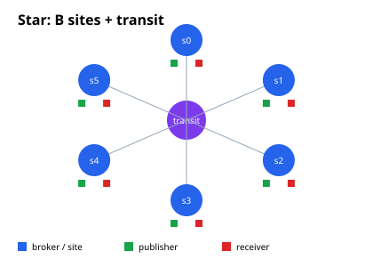
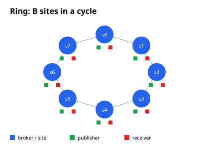
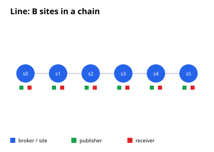

# Топологии, трафик и стоимость доставки в MQTT-сетях MqttY: единое исследование

**Аннотация.** Работа объединяет два взаимодополняющих исследования MqttY.
Первое — масштабирование числа сообщений и сетевых пакетов в зависимости от
числа брокеров $B$, клиентов $C$, сетей $N$ и публикаций $M=RT$. Второе —
полнота доставки, задержка и стоимость пересылки в трёх режимах: центральный
брокер (`single`), MqttRelay (`relay`) и статическая федерация (`federation`).
На 63 основных, 13 крупных и 18 robustness-конфигурациях показано, что
доставки в LB равны $M$, в Relay/Federation — $MB$; трафик LB линеен по длине
пути, Relay — линеен по $B$, Federation star — квадратичен по $B$, ring/line
близки к линейному. Holdout-ошибка формул 0.08–0.09 % для LB/Relay/star/line.
На 162 симуляциях основной сети single и Relay доставили 100 % ожидаемых пар;
федерация при 5000 сообщений/с и QoS 1/2 была неполной из-за переполнений
очередей. Увеличение очереди с 1024 до 4096 подняло доставку к сроку с
19.30 % до 38.26 %, но обмен не завершился. Единый вывод: подавление повторов
решает циклы, но не заменяет достаточные ресурсы, hop limit и время drain;
стоимость пересылки нужно рассматривать вместе с полнотой и задержкой.

## 1. Введение

MqttY — дискретно-событийный симулятор MQTT-сетей. Для проектирования и
интерпретации экспериментов нужны ответы на два разных вопроса:

1. **Трафик:** сколько сообщений и сетевых пакетов порождает топология при
   заданной нагрузке?
2. **Доставка:** доходит ли сообщение до всех ожидаемых получателей, с какой
   задержкой и какой ценой пересылки?

Первый вопрос определяет нагрузку на сеть и стоимость вычислений. Второй —
пригодность конкретной реализации: полноту, задержку и переполнения. Ответы
не выводятся один из другого: топология может быть дешёвой по трафику, но
медленной из-за длинных путей, и наоборот.

**Вклад.** (i) Эмпирико-аналитические формулы трафика для LB, Relay и
Federation star/ring/line. (ii) Holdout- и кросс-хостовую верификацию формул.
(iii) Единую постановку сравнения single/relay/federation по полноте,
задержке и стоимости. (iv) Анализ чувствительности к размеру очереди и
вычислительной стоимости параллельного исполнения.

## 2. Термины и обозначения

- **wall time / wall-clock** — реальное время выполнения; включает
  планировщик, GC и барьеры, в отличие от модельного времени (тиков).
- **LB** — LoadBalancing-движок MqttY: распределение клиентов по backend.
- **Holdout** — отложенная точка, не участвовавшая в подгонке коэффициентов.
- **$M=RT$** — запланированные публикации; **$D$** — уникальные доставки;
  **$X$** — сетевые пакеты; **$B$** — брокеры; **$P$** — публикаторы;
  **$C$** — клиенты; **$N$** — сети; **$L$** — длина пути; **$R$** — rps;
  **$T$** — длительность измерения.
- **Полнота** — $D/(A M_r)$, где $A$ — исходные попытки, $M_r$ — число
  ожидаемых получателей на сообщение.
- **QoS** — уровень MQTT-обмена: 0 (без подтверждений), 1 (PUBACK),
  2 (PUBREC/PUBREL/PUBCOMP).

## 3. Топологии

| Конфигурация | Смысл | $N$ | $C$ |
|---|---|---|---|
| LB | клиентская LAN + $B$ backend-цепочек длины $L$ | $1+BL$ | $P+B$ |
| Relay | star-транспорт, origin → все сайты без flood | $B+1$ | $P+3B^2$ |
| Federation star | полный граф пересылок | $B+1$ | $P+B^2+2B$ |
| Federation ring | кольцо из $B$ сайтов | $B$ | $P+5B$ |
| Federation line | цепочка из $B$ сайтов | $B$ | $P+5B-2$ |

| Star | Ring | Line |
|---|---|---|
|  |  |  |

В star-федерации физическая звезда соединяет сайты через транзитный узел, но
логический граф пересылок — полный. Поэтому «звезда» здесь не означает
звезду брокеров.

## 4. Теория

### 4.1 Доставки

$$
D_{\mathrm{LB}}=M,\qquad D_{\mathrm{Relay}}=D_{\mathrm{Fed}}=MB.
$$

Для фиксированного ID каждый федератор обрабатывает первое получение не
более одного раза. Если $m$ — число неориентированных рёбер соседства, при
полном покрытии число межброкерных экспортов одного исходного ID равно
$2m-(N-1)$: в дереве $N-1$, в кольце $N+1$, в полном графе $(N-1)^2$.
Для Relay верхняя граница — $N-1$ экспортов, импорт не переэкспортируется.
Достаточный hop limit для полного обхода — $H\ge N$; при $H=N-1$
первое получение образует дерево, но точное число всех экспортов требует
$H\ge N$.

### 4.2 Трафик

$$
X_{\mathrm{LB}}/M \approx 4(L+1),
$$
$$
X_{\mathrm{Relay}}/M \approx 12.29B-4.46,
$$
$$
X_{\mathrm{Fed,star}}/M \approx 8.08B^2-11.98B+11.84,
$$
$$
X_{\mathrm{Fed,ring}}/M \approx 10.70B+2.78,\qquad
X_{\mathrm{Fed,line}}/M \approx 10.12B-1.96.
$$

LB при QoS 1 тратит четыре пакета на путь (PUBLISH, PUBACK, доставка,
подтверждение); QoS 0/2 дают множители примерно $2^{Q+1}$.

## 5. Методика

### 5.1 Программа A: трафик и топологии

- 63 основных наблюдения: 19 LB, 28 Federation (star/ring/line), 16 Relay;
- 13 крупных конфигураций: LB до $B=64$, $N=257$, $C=2112$;
  Fed/Relay до $B=16$, $P=2048$, $C=2336$;
- 18 robustness-прогонов: QoS 0/1/2 × seed 1/7/42;
- два хоста: Xeon E5-2680 v3 (12C/24T) и Celeron N3350 (2C/2T);
- `measure=1–3 с`, `warmup=0.01 с`, `drain=10 с`, payload 16 байт;
- OLS-регрессии, $R^2$, RMSE, holdout на $B=16$/$L=4$, bootstrap 95 % CI.

Скрипты: `run_campaign.py`, `run_large.py`, `run_robustness.py`,
`analyze.py`, `analyze_large.py`.

### 5.2 Программа B: доставка и стоимость

Основная сеть: 162 симуляции и 6 точных повторов — 3 режима × 3 физические
сети × 3 QoS × 2 интенсивности × 3 seed. Четыре площадки, 64 отправителя,
четыре получателя, сообщение 16 байт; подача 10 модельных секунд, прогрев 1 с,
drain до 30 с; идеальные брокеры; очередь федератора 1024, кэш 100000 ID,
hop limit 4.

Дополнительно: опыт с очередью 1024/4096 для одной точки (QoS 2, 5000
сообщений/с) и вычислительная серия на контрольной модели LB (4/16/64
backend, 250/1000/4000 публикаций/с на backend, три платформы).

## 6. Результаты A: трафик

| Топология | Модель $X/M$ | $R^2$ | Holdout |
|---|---|---|---:|---:|
| LB | $4.07L+3.95$ + setup | 0.99999 | 0.08 % |
| Relay | $12.291B-4.461$ | 0.99992 | 0.08 % |
| Fed star | $8.077B^2-11.977B+11.836$ | 0.999998 | 0.09 % |
| Fed ring | $10.700B+2.782$ | 0.9946 | 9.1 % |
| Fed line | $10.120B-1.964$ | 1.0000 | <0.01 % |

При $B=16$, $P=1024$:

| Топология | $X$, млн | wall, с | speedup |
|---|---:|---:|---:|
| star | 3.78 | 4.23 | 4.45× |
| ring | 0.346 | 1.92 | 3.94× |
| line | 0.322 | 3.18 | 2.59× |
| relay | 0.385 | 2.02 | 3.91× |

Крупные конфигурации: ошибка формул ≤ 2.3 % до границы ёмкости. При
5000 сообщений/с Federation star доставляет 65 140 из 80 000 пар
($D/(MB)=0.814$), и модель трафика переоценивает $X$ на 55 % — это граница
применимости, а не ошибка коэффициентов.

QoS: LB $X/M$ = 10.87 / 20.97 / 41.17; Fed star = 945.5 / 1888.8 / 3775.5
для QoS 0/1/2. Seed 1/7/42 дал побитово одинаковые $M$, $D$, $X$.
На Celeron и Xeon счётчики совпали (0–0.1 %), различается только speedup
(1.5–1.7× против 3.9–5.7×).

## 7. Результаты B: доставка и стоимость

### 7.1 Полнота и задержка

| Сеть | QoS | Сообщ./с | Полнота Fed, % | p99 single | p99 Relay | p99 Fed |
|---|---:|---:|---:|---:|---:|---:|
| Линия | 0 | 1000 | 100.000 | 2.0 | 3.0 | 5.0 |
| Линия | 0 | 5000 | 100.000 | 2.0 | 3.0 | 5.0 |
| Линия | 1 | 1000 | 100.000 | 2.0 | 3.0 | 7.4 |
| Линия | 1 | 5000 | 29.845 | 2.0 | 3.0 | 3996.7 |
| Линия | 2 | 1000 | 82.157 | 6.0 | 9.0 | 5056.0 |
| Линия | 2 | 5000 | 19.419 | 6.0 | 9.0 | 8993.4 |
| Кольцо | 0 | 1000 | 100.000 | 1.6 | 2.8 | 3.9 |
| Кольцо | 0 | 5000 | 100.000 | 1.6 | 2.8 | 3.9 |
| Кольцо | 1 | 1000 | 100.000 | 1.6 | 2.8 | 5.5 |
| Кольцо | 1 | 5000 | 30.144 | 1.6 | 2.8 | 4846.0 |
| Кольцо | 2 | 1000 | 86.933 | 4.8 | 8.4 | 7619.6 |
| Кольцо | 2 | 5000 | 19.505 | 4.8 | 8.4 | 8487.7 |
| Звезда | 0 | 1000 | 100.000 | 1.6 | 2.8 | 3.0 |
| Звезда | 0 | 5000 | 100.000 | 1.6 | 2.8 | 3.0 |
| Звезда | 1 | 1000 | 100.000 | 1.6 | 2.8 | 1568.7 |
| Звезда | 1 | 5000 | 29.290 | 1.6 | 2.8 | 4406.1 |
| Звезда | 2 | 1000 | 89.850 | 4.8 | 8.4 | 8164.9 |
| Звезда | 2 | 5000 | 19.305 | 4.8 | 8.4 | 8510.1 |

Single и Relay доставили 100 % во всех 54 запусках. Федерация при QoS 0
доставила всё; при QoS 1/5000 и QoS 2 полнота падает до ~19–30 %,
одновременно фиксируются переполнения очередей. Низкая задержка среди
немногих полученных сообщений не означает хорошей работы сети.

### 7.2 Пересылка и транзит

При полной доставке Relay делает три экспорта на публикацию (при 1000
сообщений/с — 30 000 пересылок). Федерация линии при QoS 0 делает те же
30 000 экспортов, но передаёт 1 341 012 байт; кольца — 50 000 и
2 235 020 байт. Разница — служебные темы и пути.

Пример физического транзита звезды (QoS 2, 5000 сообщений/с, среднее трёх
запусков):

| Режим | Вход в транзит, байт | Пакетов | Отказов |
|---|---:|---:|---:|
| single | 10 500 000 | 750 000 | 0 |
| relay | 8 100 000 | 600 000 | 0 |
| federation | 4 265 132 | 269 404 | 0 |

У федерации здесь полнота лишь 19.305 %, поэтому меньший обмен нельзя
считать преимуществом.

### 7.3 Размер очереди

Для QoS 2, 5000 сообщений/с, четырёх площадок и 64 отправителей:

| Очередь | Доставлено к сроку | Полнота | Отказы очереди |
|---:|---:|---:|---:|
| 1024 | 38 609 | 19.3045 % | 203 360 |
| 4096 | 76 513 | 38.2565 % | 173 286 |

Вариант 4096 не завершил обмен и сохранил `failed`; 61.74 % неполученных пар
нельзя объявлять окончательными потерями — часть оставалась в пути.
Увеличение буфера улучшает доставку к сроку, но не гарантирует завершение.

### 7.4 Вычислительная стоимость

Контрольная LB-модель: 4/16/64 backend, 250/1000/4000 публикаций/с на
backend, три платформы. При 64 backend отношение медиан Refresh
serial/parallel: i7 1.338–1.346×, Xeon 1.190–1.268×, Эльбрус 1.377–1.413×.
Выигрыш сопровождается ростом CPU: parallel/serial 1.46–1.54× (i7),
1.93–1.96× (Xeon), 1.22–1.24× (Эльбрус). На малых графах параллельный режим
часто медленнее; гарантированного ускорения нет.

## 8. Обсуждение

1. **Трафик vs доставка.** Star дешевле по задержке (короткий путь), но
   дороже по трафику ($O(B^2)$) и чувствителен к переполнению очередей.
   Ring/line дешевле по трафику, но имеют длинные пути и больший drain.
2. **Relay vs Federation.** Relay линеен по $B$ и доставил всё; федерация
   подавляет повторы, но flood-пересылки и ограниченные очереди снижают
   полноту при высокой нагрузке. Подавление повторов — необходимое, но не
   достаточное условие доставки.
3. **Ёмкость важнее алгоритма в перегрузке.** Очередь 4096 удвоила полноту
   к сроку, но не завершила обмен; hop limit, очередь и drain нужно
   рассматривать вместе.
4. **Модель трафика инвариантна к хосту**, speedup — нет. На 2 ядрах
   ускорение 1.5–1.7×, на 12 — 3.9–5.7×.
5. **Границы.** Federation $B\le16$; payload 16 байт; идеальные брокеры;
   профили с потерями и натурная сеть требуют отдельных серий.

## 9. Ограничения

- только payload 16 байт и идеальные брокеры в основной сети;
- Federation $B\le16$, очередь и hop limit фиксированы;
- ring при малых $B$ имеет конечномерную кривизну (holdout 9.1 %);
- вычислительная серия не является натурным сравнением брокеров;
- wall-clock зависит от теплового/фонового шума (CI ±3–5 %).

## 10. Заключение

Единая картина: **доставка** определяется нагрузкой и топологией
($D=M$ в LB, $D=MB$ в Relay/Federation), **трафик** — длиной пути и
структурой пересылок (LB $O(MN)$, Relay $O(MN)$, Fed star $O(MN^2)$,
ring/line $O(MN)$), а **успех доставки** — ещё и очередями, hop limit и
временем drain. Формулы трафика проверены holdout- и кросс-хостовой
верификацией; эксперименты с очередью показывают, что подавление повторов
само по себе не обеспечивает полноту при ограниченных ресурсах.

## 11. Источники и данные

1. Ribas N. K., Spohn M. A. A New Approach to a Self-Organizing Federation of
   MQTT Brokers. Journal of Computer Science 18(7), 2022.
2. Eclipse Mosquitto. mosquitto.conf: Configuring Bridges.
3. Солопий А. В., Классен Р. К. Выбор брокера сообщений для Интернета вещей.
   Динамика сложных систем — XXI век, 2025.
4. Solopiy A., Klassen R. Simulation of Distributed Networks of IoT.
   RusAutoCon 2025.
5. Солопий А. В., Классен Р. К. MqttY: ускорение симуляции больших сетей.
   Computational Nanotechnology, 2026.
6. OASIS. MQTT Version 3.1.1, 2014.
7. Lima K. et al. Evaluation of MQTT Bridge Architectures, arXiv:2501.14890.

Локальные данные: `measurements.csv`, `large-topologies.csv`,
`robustness.csv`, `hardware-validation.csv`, `results.json`,
`topologies.md`, `topologies-summary.md`, [article.md](article.md).
Внешняя серия доставки и стоимости:
[article-2-relay-federation.md](https://github.com/EntityFX/mqtty-meta/blob/develop/docs/dissertation/articles/article-2-relay-federation.md).

## 12. Воспроизводимость

```bash
python3 doc/analysis/message-scaling/run_campaign.py
python3 doc/analysis/message-scaling/run_large.py
python3 doc/analysis/message-scaling/run_robustness.py
python3 doc/analysis/message-scaling/analyze.py
python3 doc/analysis/message-scaling/analyze_large.py
```
