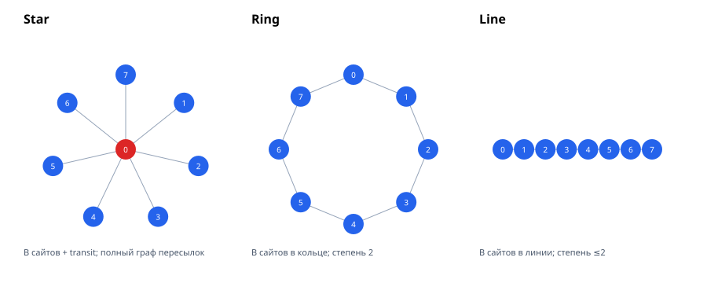

# Топологии MqttY: сводка и научные результаты

**Краткая выжимка.** В работе измерена связь числа прикладных и сетевых
сообщений с числом брокеров \(B\), клиентов \(C\), сетей \(N\) и публикаций
\(M=RT\). Показано: доставки в LoadBalancing равны \(M\), в Relay и Federation
— \(MB\); сетевой трафик LB линеен по длине пути, Relay — линеен по \(B\),
Federation star — квадратичен по \(B\), ring/line — близки к линейному.
Формулы проверены на 63 основных, 13 крупных и 18 robustness-конфигурациях,
на двух хостах; holdout-ошибка 0.08–0.09 % для LB/Relay/star/line.

## 1. Что исследуется

Объект — дискретно-событийный симулятор MQTT-сетей MqttY. Исследуется, как
топология влияет на:

- число доставок получателям \(D\);
- число сетевых пакетов \(X\) (сумма inbound/outbound);
- стоимость по wall-clock и параллельное ускорение.

Рассматриваются пять конфигураций:

| Конфигурация | Смысл |
|---|---|
| LoadBalancing (LB) | клиентская LAN + \(B\) backend-цепочек длины \(L\) |
| Relay | star-транспорт, пересылка origin → все сайты без flood |
| Federation star | полный граф пересылок между \(B\) сайтами |
| Federation ring | кольцо из \(B\) сайтов |
| Federation line | цепочка из \(B\) сайтов |



## 2. Как это делается

### 2.1 Переменные и аналитические ожидания

\[
M=RT,\qquad D_{\mathrm{LB}}=M,\qquad D_{\mathrm{Relay}}=D_{\mathrm{Fed}}=MB.
\]

Число сетей и клиентов:

\[
N_{\mathrm{LB}}=1+BL,\quad C_{\mathrm{LB}}=P+B;
\]
\[
N_{\mathrm{Relay}}=N_{\mathrm{Fed,star}}=B+1,\quad
C_{\mathrm{Relay}}=P+3B^2,\quad
C_{\mathrm{Fed,star}}=P+B^2+2B.
\]

Ожидаемые законы трафика:

\[
X_{\mathrm{LB}}/M \approx 4(L+1),
\]
\[
X_{\mathrm{Relay}}/M \approx 12.29B - 4.46,
\]
\[
X_{\mathrm{Fed,star}}/M \approx 8.08B^2 - 11.98B + 11.84,
\]
\[
X_{\mathrm{Fed,ring}}/M \approx 10.70B + 2.78,\qquad
X_{\mathrm{Fed,line}}/M \approx 10.12B - 1.96.
\]

### 2.2 Экспериментальный дизайн

- 63 основных наблюдения: 19 LB, 28 Federation (star/ring/line), 16 Relay;
- 13 крупных конфигураций: LB до \(B=64\), \(N=257\), \(C=2112\);
  Fed/Relay до \(B=16\), \(P=2048\), \(C=2336\);
- 18 robustness-прогонов: QoS 0/1/2 × seed 1/7/42;
- два хоста: Xeon E5-2680 v3 (12C/24T) и Celeron N3350 (2C/2T);
- `measure=1–3 с`, `warmup=0.01 с`, `drain=10 с`, seed 42 (кроме
  robustness), QoS 1 (кроме robustness), payload 16 байт.

### 2.3 Обработка

- OLS-регрессии и \(R^2\), RMSE;
- holdout: обучение на \(B<16\) (LB — \(L<4\)), проверка на \(B=16\);
- bootstrap 95 % CI для benchmark speedup (2000 ресэмплов);
- проверка аппаратной инвариантности счётчиков на двух хостах.

Инструменты и данные: `run_campaign.py`, `run_large.py`,
`run_robustness.py`, `analyze.py`, `analyze_large.py`,
`measurements.csv`, `large-topologies.csv`, `robustness.csv`.

## 3. Результаты

### 3.1 Модели трафика

| Топология | Модель \(X/M\) | \(R^2\) | holdout \(B=16\) |
|---|---|---:|---:|
| LB | \(4.07L+3.95\) + setup | 0.99999 | 0.08 % (\(L=4\)) |
| Relay | \(12.291B-4.461\) | 0.99992 | 0.08 % |
| Fed star | \(8.077B^2-11.977B+11.836\) | 0.999998 | 0.09 % |
| Fed ring | \(10.700B+2.782\) | 0.9946 | 9.1 % |
| Fed line | \(10.120B-1.964\) | 1.0000 | <0.01 % |

LB: \(X \approx 4M(L+1)+19.7B+8.14P-44\).

### 3.2 Сравнение при \(B=16\)

| Топология | \(X\), млн пакетов | wall, с | speedup |
|---|---:|---:|---:|
| star | 3.78 | 4.23 | 4.45× |
| ring | 0.346 | **1.92** | 3.94× |
| line | 0.322 | 3.18 | 2.59× |
| relay | 0.385 | 2.02 | 3.91× |

Star даёт максимальный трафик, но минимальную длину пути. Ring — лучший
баланс на больших \(B\); line дешевле по трафику, но медленнее из-за длинных
путей и drain-хвоста.

### 3.3 Крупные топологии

| Конфиг | \(X\) теория | \(X\) факт | ошибка |
|---|---:|---:|---:|
| LB B64 L4 P2048 | 422 428 | 425 760 | 0.78 % |
| Fed star B16 P2048 | 3 775 954 | 3 779 088 | 0.083 % |
| Fed ring B16 P1024 | 347 965 | 345 768 | 0.64 % |
| Fed line B16 P1024 | 319 912 | 321 520 | 0.50 % |
| Relay B16 P1024 | 384 376 | 384 848 | 0.12 % |

При \(R=5000\) в Federation начинается насыщение: доставлено 65 140 из
80 000 (\(D/(MB)=0.814\)), модель переоценивает трафик на 55 %. Это граница
применимости, а не ошибка коэффициентов.

### 3.4 QoS и seed

| QoS | LB \(X/M\) | Fed star \(X/M\) |
|---:|---:|---:|
| 0 | 10.87 | 945.48 |
| 1 | 20.97 | 1888.82 |
| 2 | 41.17 | 3775.50 |

Масштаб LB — \(2^{Q+1}\) пакетов на путь; Fed — множитель \(2^{Q-1}\) к QoS 1.
Для seed 1/7/42 значения \(M\), \(D\), \(X\) совпали побитово (разброс 0).

### 3.5 Аппаратная инвариантность

На Celeron N3350 и Xeon E5-2680 v3 одинаковые конфигурации дают одинаковые
\(M\), \(D\), \(X\) (0–0.1 %). Различается только скорость: на 2 ядрах
speedup 1.5–1.7×, на 12 ядрах 3.9–5.7×.

## 4. Выводы

1. **Доставки** определяются нагрузкой и топологией: LB \(D=M\);
   Relay/Federation \(D=MB\).
2. **Трафик LB** растёт линейно по числу сетей/длине пути:
   \(X=O(MN)\).
3. **Relay** линеен по \(B\): \(X=O(MN)\), без flood-размножения.
4. **Federation star** квадратична по \(B\): \(X=O(MN^2)\), из-за полного
   графа пересылок.
5. **Federation ring/line** близки к линейному закону; ring имеет
   конечномерную кривизну (holdout 9.1 %), line описывается точно.
6. **QoS** меняет коэффициент, но не топологический порядок роста.
7. **Seed** не влияет на идеальную модель; аппаратная платформа влияет
   только на speedup, не на счётчики сообщений.

## 5. Ограничения

- payload только 16 байт;
- Federation \(B\le16\);
- профили с потерями/queueDrops требуют отдельной серии;
- ring при малых \(B\) требует отдельной модели;
- benchmark speedup зависит от теплового/фонового шума (CI ±3–5 %).

## 6. Воспроизводимость

```bash
python3 doc/analysis/message-scaling/run_campaign.py
python3 doc/analysis/message-scaling/run_large.py
python3 doc/analysis/message-scaling/run_robustness.py
python3 doc/analysis/message-scaling/analyze.py
python3 doc/analysis/message-scaling/analyze_large.py
```

Подробности: [article.md](article.md), [topologies.md](topologies.md),
`measurements.csv`, `large-topologies.csv`, `robustness.csv`,
`results.json`.
