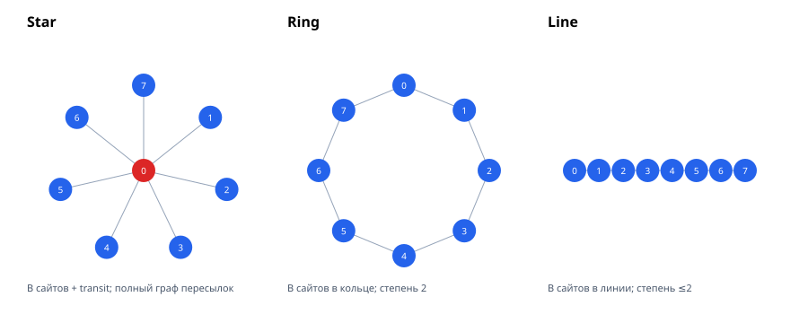

# Топологии MqttY: отдельное описание

Краткая сводка и научные выводы — в [topologies-summary.md](topologies-summary.md).
Документ описывает каждую топологию отдельно: граф, число сетей и клиентов,
маршруты сообщений, модель трафика и проверенные замеры. Сводная статья и
регрессии — в [article.md](article.md), данные — в
[measurements.csv](measurements.csv).



## 0. Обозначения

| Символ | Смысл |
|---|---|
| \(B\) | число брокеров / сайтов |
| \(P\) | число публикующих клиентов |
| \(R\) | предложенная интенсивность, сообщений/с |
| \(M=RT\) | запланированные публикации |
| \(D\) | уникальные доставки получателям |
| \(X\) | сетевые пакеты (сумма inbound/outbound) |
| \(N\) | число сетей |
| \(C\) | всего клиентов (publishers + receivers + служебные) |
| \(L\) | число hop-сетей на backend (только LB) |

Общие определения:

\[
D_{\mathrm{Relay}}=D_{\mathrm{Fed}}=MB,\qquad D_{\mathrm{LB}}=M.
\]

Во всех федеративных топологиях одна публикация доставляется на все \(B\)
сайтов; различаются пересылки между сайтами.

## 1. Star (звезда)

### Граф

\(B\) сайтов подключены к одному транзитному узлу `transit`:

\[
N_{\mathrm{star}} = B+1.
\]

Физические рёбра: `site_i — transit`. Логические рёбра пересылок
(`ForwardingEdges`) для star-топологии — **полный граф**:

\[
E_{\mathrm{star}} = \frac{B(B-1)}{2}.
\]

### Клиенты

На каждом сайте:

- 1 входной listener;
- `degree + 1` выходных клиентов: \(B-1\) соседей + self.

С учётом \(P\) публикаторов и \(B\) получателей:

\[
C_{\mathrm{star}} = P + B + B(B+1) = P + B^2 + 2B.
\]

### Маршруты и трафик

Каждая публикация уходит на все \(B\) сайтов. Каждый сайт пересылает её
остальным сайтам; при подавлении повторов число пересылок на публикацию
растёт как \(B(B-1)\). Поэтому star — единственная из трёх топологий с
**квадратичным** сетевым трафиком:

\[
X_{\mathrm{star}}/M = 8.077B^2 - 11.977B + 11.836,
\]
\[
R^2 = 0.9999998,\qquad \text{holdout } B=16:\ 0.09\ \%.
\]

### Замеры

| \(B\) | \(N\) | \(C\) при \(P=32\) | \(X/M\) |
|---:|---:|---:|---:|
| 2 | 3 | 40 | 20.30 |
| 4 | 5 | 56 | 93.10 |
| 8 | 9 | 112 | 432.78 |
| 16 | 17 | 320 | 1888.38 |

При \(B=16\) star создаёт почти в 11 раз больше пакетов, чем ring/line.

## 2. Ring (кольцо)

### Граф

\(B\) сайтов соединены в кольцо:

\[
N_{\mathrm{ring}} = B,
\]
\[
E_{\mathrm{ring}} = B \quad (B>2).
\]

Рёбра: `(i, i+1)` и замыкающее `(0, B−1)`.

### Клиенты

У каждого сайта степень 2, поэтому выходных клиентов `degree + 1 = 3`:

\[
C_{\mathrm{ring}} = P + B + B(3+1) = P + 5B.
\]

### Маршруты и трафик

Публикация распространяется в двух направлениях; повторно пришедшее
сообщение подавляется. Каждое ребро используется не более одного раза,
поэтому число пересылок растёт линейно по \(B\), а не квадратично. Средняя
длина пути растёт с диаметром кольца \(\lfloor B/2\rfloor\), что даёт
небольшую кривизну:

\[
X_{\mathrm{ring}}/M \approx 10.700B + 2.782,
\]
\[
R^2 = 0.9946.
\]

Линейная модель хорошо работает при больших \(B\), но на holdout \(B=16\)
даёт 9.1 % ошибки из-за конечного диаметра; для точных расчётов при малых
\(B\) нужна отдельная поправка.

### Замеры

| \(B\) | \(N\) | \(C\) при \(P=32\) | \(X/M\) |
|---:|---:|---:|---:|
| 2 | 2 | 42 | 18.28 |
| 4 | 4 | 52 | 50.64 |
| 8 | 8 | 72 | 91.12 |
| 16 | 16 | 112 | 172.08 |

## 3. Line (линия)

### Граф

\(B\) сайтов соединены в цепочку:

\[
N_{\mathrm{line}} = B,
\]
\[
E_{\mathrm{line}} = B-1.
\]

### Клиенты

Степень внутренних сайтов 2, крайних — 1:

\[
\sum_i (\deg_i + 1) = 2(B-1) + B = 3B-2,
\]
\[
C_{\mathrm{line}} = P + B + B + (3B-2) = P + 5B - 2.
\]

### Маршруты и трафик

Публикация идёт от origin в обе стороны; каждое ребро пересекается не более
одного раза. По сравнению с ring меньше альтернативных путей и короче
средний маршрут, поэтому коэффициент ниже. Line описывается линейной
моделью **точно** на всём диапазоне:

\[
X_{\mathrm{line}}/M = 10.120B - 1.964,
\]
\[
R^2 = 1.0000,\qquad \text{holdout } B=16:\ <0.01\ \%.
\]

### Замеры

| \(B\) | \(N\) | \(C\) при \(P=32\) | \(X/M\) |
|---:|---:|---:|---:|
| 2 | 2 | 40 | 18.28 |
| 4 | 4 | 50 | 38.52 |
| 8 | 8 | 70 | 79.00 |
| 16 | 16 | 110 | 159.96 |

## 4. Relay (star, без flood-размножения)

Relay использует star-транспорт, но политика пересылки другая: сайт-origin
отправляет сообщение один раз в каждый удалённый сайт; импортные сообщения
доставляются локально и **не экспортируются дальше**. Поэтому:

\[
N_{\mathrm{Relay}} = B+1,\qquad C_{\mathrm{Relay}} = P + 3B^2,
\]
\[
D_{\mathrm{Relay}} = MB,
\]
\[
X_{\mathrm{Relay}}/M = 12.291B - 4.461,
\]
\[
R^2 = 0.99992,\qquad \text{holdout } B=16:\ 0.08\ \%.
\]

Это линейный аналог star: доставки как у федерации, но без квадратичных
пересылок.

## 5. LoadBalancing (для сравнения)

LB не является федеративной топологией: клиентская LAN соединена с \(B\)
backend-цепочками длины \(L\).

\[
N_{\mathrm{LB}} = 1 + BL,\qquad C_{\mathrm{LB}} = P+B.
\]

Каждая публикация доставляется одному получателю (\(D=M\)); при QoS 1
четыре пакета проходят \(L+1\) сетей:

\[
X_{\mathrm{LB}}/M \approx 4(L+1),
\]
\[
X_{\mathrm{LB}} \approx 4M(L+1) + 19.7B + 8.14P - 44.
\]

## 6. Сводное сравнение

| Топология | \(N\) | \(C\) | \(D\) | \(X/M\) | Рост |
|---|---:|---|---:|---|---|
| LB | \(1+BL\) | \(P+B\) | \(M\) | \(4(L+1)\) | \(O(MN)\) |
| Relay | \(B+1\) | \(P+3B^2\) | \(MB\) | \(12.291B-4.461\) | \(O(MN)\) |
| Fed star | \(B+1\) | \(P+B^2+2B\) | \(MB\) | \(8.077B^2-11.977B+11.836\) | \(O(MN^2)\) |
| Fed ring | \(B\) | \(P+5B\) | \(MB\) | \(10.700B+2.782\) | \(O(MN)\) |
| Fed line | \(B\) | \(P+5B-2\) | \(MB\) | \(10.120B-1.964\) | \(O(MN)\) |

При \(B=16\): star \(X/M=1888\), ring 172, line 160. Star выгоден по
задержке (короткий путь через transit), но дорог по трафику; ring/line
дешевле по трафику, но имеют более длинные пути и худшую связность.

## 7. Выбор топологии

- **Star** — когда важна минимальная задержка и допустим квадратичный
  трафик; типично для небольших \(B\).
- **Ring** — компромисс: линейный трафик, устойчивость к отказу одного
  ребра, но диаметр растёт с \(B\).
- **Line** — минимальный трафик и простая модель, но самая длинная
  средняя доставка и нет резервных путей.
- **Relay** — если нужна доставка на все сайты без flood-размножения;
  трафик линейный, задержка star-уровня.
- **LB** — когда важна не федерация, а балансировка клиентов по бэкендам.

## 8. Поведение на больших топологиях

При \(B=16\), \(P=1024\), \(R=2000\) (12-ядерный Xeon):

| Топология | \(X\), млн пакетов | wall, с | wall × | Комментарий |
|---|---:|---:|---:|---|
| star | 3.78 | 4.23 | 4.45 | максимум трафика, короткий путь |
| ring | 0.346 | 1.92 | 3.94 | минимум wall при \(B=16\) |
| line | 0.322 | 3.18 | 2.59 | меньше трафика, но длинные пути |
| relay | 0.385 | 2.02 | 3.91 | линейный трафик, star-задержка |

LB на \(B=64\), \(L=4\), \(P=2048\): \(N=257\), \(C=2112\), \(X=425\,760\),
wall 2.57 с, speedup 3.57×. Рост \(P\) снижает параллельную эффективность
LB, но почти не меняет \(X/M\).

Подробные таблицы «теория vs факт», holdout-ошибки и сравнение слабого и
сильного хостов — в [article.md](article.md), раздел 5.7.

## 9. Воспроизводимость

```bash
python3 doc/analysis/message-scaling/run_campaign.py
python3 doc/analysis/message-scaling/analyze.py
```

Топология задаётся в benchmark:

```bash
--fed-topology star|ring|line
```

Артефакты: `measurements.csv` (63 точки), `results.json` (коэффициенты,
\(R^2\), holdout), `figures/topologies.svg`.
