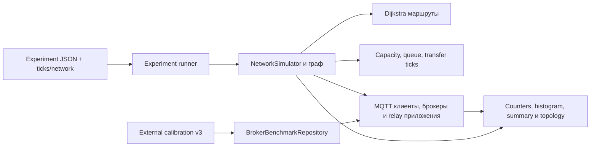

# Архитектура MqttY

MqttY — дискретный симулятор сетей и MQTT-процессов. Он не запускает реальный Mosquitto/EMQX и не исполняет их бинарный код. Benchmark измеряет установку, calibration задаёт параметры поведения, experiment воспроизводит обмен в абстрактной сети.

## Ядро, граф и время

NetworkSimulator хранит области Network, конечные nodes и направленные связи. DijkstraPathFinder строит маршруты; после изменения topology вызывается UpdateRoutes. В каждом Refresh обрабатываются nodes/пакеты/таймауты и увеличивается модельное время. TickPeriod преобразует ticks в duration; network TransferTicks и OutgoingWaitTicks — разные задержки.

NetworkOptions задаёт bytes/s capacity, queue capacity, throughput window и transfer ticks. Эти входы не восстанавливаются из CPU/RSS реального брокера. Маршрут, queues, задержки и дисциплина обновления влияют на offered/completed load и ACK latency. Для deterministic fidelity используется sequential refresh; parallel+fidelityMode отклоняется.

## MQTT и приложения

MqttClient обрабатывает connect/subscription/publish и MQTT acknowledgement state. MqttNetworkBuilder создаёт брокеры через MQTT packet manager/topic evaluator. CONNECT/CONNACK и SUBSCRIBE/SUBACK barriers предшествуют измерению. QoS1 completion связан с PUBACK, QoS2 — с PUBREC/PUBREL/PUBCOMP; QoS0 не имеет ACK latency. Wildcard topic evaluation и relay forwarding остаются протокольными механизмами модели.

BrokerFidelity создаёт N publishers и subscriber для области. MqttRelay добавляет listeners/forwarders/receivers между областями. BrokerAssignmentMode выбирает ideal, один тип или mixed array. ProfileClientCountMode определяет lookup: N publishers или все connectedClients. Manifest записывает выбор и actual count; v3 calibration построена на оси publishers.

## Профиль брокера

BrokerBenchmarkRepository читает внешний v3 artifact и предоставляет профиль broker/messageBytes/QoS/client count. Capacity/rate rejection, conditional publish failure, conditional delivery loss и processing latency — отдельные model gates; observed targets используются для comparisons. Seed влияет на случайные решения. Interpolation между профильными точками — допущение, требующее самостоятельной проверки.

Ресурсная модель CPU/памяти/энергии не появляется от импорта телеметрии. Отдельная stateful эмуляция внутреннего кода брокеров также отсутствует. Точный контракт преобразования: [calibration](calibration-v3.md).

## Конфигурация и наблюдаемость

CLI calibrate фиксирует clean MqttY commit и input SHA. CLI experiment фиксирует оба clean commits и hash bytes профиля, затем runner управляет warmup/measurement/drain/export. Raw counts, failure/loss, latency histogram, phase state и acceptance criteria находятся в summary/counters; topology экспортируется в GraphML/PlantUML.

| Реализация | Каталог |
|---|---|
| Public contracts, options | [Contracts](../src/EntityFX.MqttSimulator/EntityFX.MqttSimulator.Contracts/), [MQTT contracts](../src/EntityFX.MqttSimulator/EntityFX.MqttY.Contracts.Mqtt/) |
| Ядро, сеть и маршруты | [Network](../src/EntityFX.MqttSimulator/EntityFX.MqttSimulator/Network/) |
| MQTT builders, clients, brokers, профили | [Plugin.Mqtt](../src/EntityFX.MqttSimulator/EntityFX.MqttY.Plugin.Mqtt/) |
| Experiment runner | [Experiments](../src/EntityFX.MqttSimulator/EntityFX.MqttY.Plugin.Mqtt/Experiments/) |
| CLI calibrate/experiment | [MqttRelay.App](../src/EntityFX.MqttSimulator/EntityFX.MqttY.MqttRelay.App/) |
| Механизмы, протокол и regressions | [Tests.Integration](../src/EntityFX.MqttSimulator/EntityFX.Tests.Integration/) |

Собственную небольшую topology можно построить через public API без изменения runtime: [компилируемый пример](custom-topology.md). Научные границы и критерии сравнения: [валидация](validation.md).
