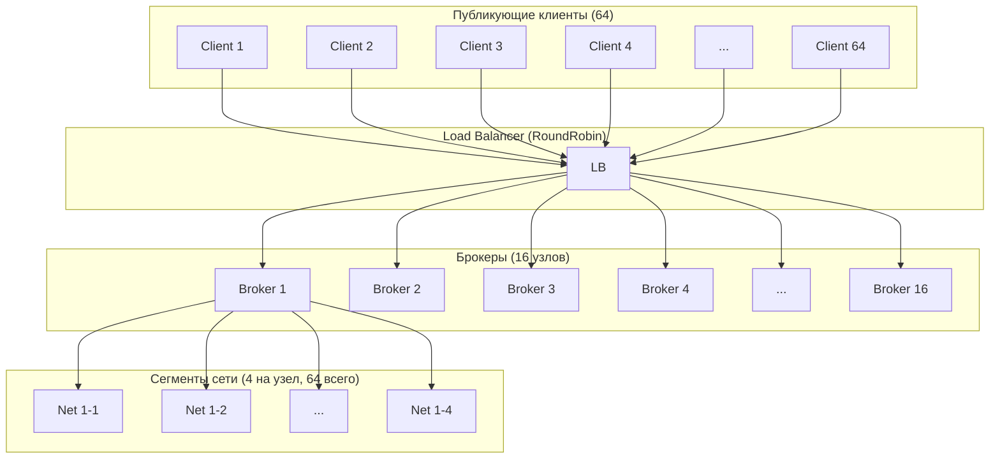
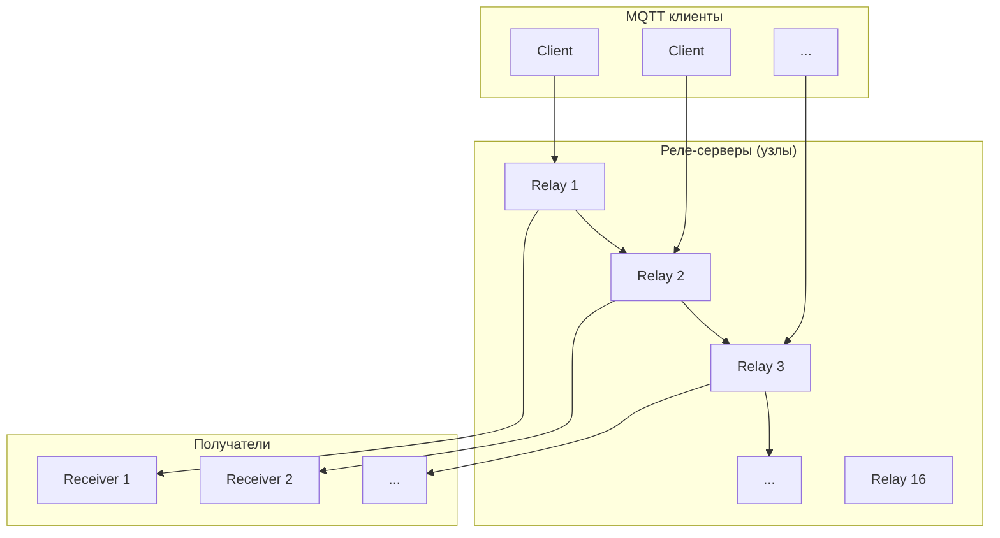
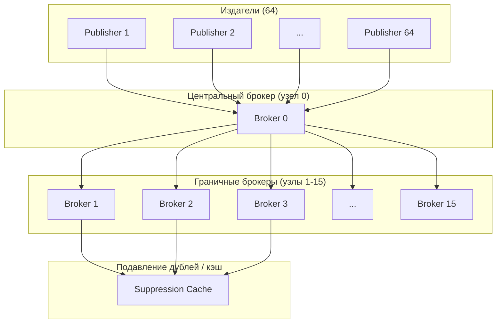

# Сравнительный бенчмарк последовательного и параллельного выполнения симуляции MQTT-сетей

**Проект:** MqttY — симулятор MQTT-брокеров и сетей  
**Ветка:** develop  
**Движки:** LoadBalancing, Relay, Federation  
**Режимы:** последовательный (`parallel=false`) vs параллельный (`parallel=true`)

---

## Аннотация

В работе проведено сравнительное исследование влияния параллельного обновления графа симуляции на wall-clock время выполнения трёх движков симулятора MQTT-сетей MqttY: нагрузочного балансировщика (LoadBalancing), реле-сети (Relay) и федерации брокеров (Federation). Показано, что параллельный режим ускоряет выполнение в 1,52–2,44 раза при сохранении идентичности научных метрик (goodput, p99-латентность, ошибки доставки), что подтверждает детерминизм модели.

---

## 1. Введение

MqttY — это симулятор сетей MQTT-брокеров, исполняющий клиентов, брокеры, сетевые задержки, очереди и протокольные обмены в модельном времени. Ядро симуляции обновляет граф сети тик за тиком. Обновление графа может выполняться либо последовательно (один поток), либо параллельно (worker-pool, `TickWorkerPool`), что позволяет снизить wall-clock время при больших топологиях.

Цель исследования — количественно оценить прирост производительности при включении параллельного режима на большом числе узлов и сегментов сети, а также проверить, не влияет ли параллельность на научные метрики симуляции.

---

## 2. Методология

### 2.1 Испытуемые движки

1. **LoadBalancing** — назначение MQTT-соединений к брокерам (режим RoundRobin), идеальные брокеры без реальных профилей.
2. **Relay** — сетевая топология с реле-серверами и получателями, обмен телеметрией.
3. **Federation** — федеративная сеть брокеров (топология star), подавление дублей, кэширование.

### 2.2 Параметры эксперимента

| Параметр | Значение |
|---|---|
| Узлов (брокеров/релеев) | 16 |
| Сегментов сети на узел | 4 (всего 64, лимит 1024) |
| Публикующих клиентов | 64 |
| Измерение | 0,5 модельной секунды |
| Прогрев | 0,01 с |
| Толчок тика | 0,1 мс |
| Нагрузка (LB / Relay) | 10 000 р/с |
| Нагрузка (Federation) | 5 000 р/с (снижена для стабильности star-топологии) |

Флаг параллелизма передаётся в метод раннера (`RunMeasured` / `ExecuteSimulation` с `parallel=false` / `parallel=true`). Каждый режим запускался дважды с одинаковым сидом и конфигурацией.

### 2.3 Измеряемые метрики

- Wall-clock время выполнения (секунды)
- Время фазы measure (секунды)
- Время refresh графа (секунды)
- Goodput (уникально доставленных сообщений в секунду)
- p99-латентность публикации и получения (мс)
- Ошибки графа и ошибки доставки

### 2.4 Топологии экспериментов

#### LoadBalancing — топология балансировки нагрузки (RoundRobin)



#### Relay — топология реле-сети



#### Federation — топология федерации (звезда)



---

## 3. Результаты

### 3.1 Итоговая таблица

| Движок | Последов. (с) | Параллель (с) | Прирост | Быстрее на | Статус |
|---|---|---|---|---|---|
| LoadBalancing | 1,48 | 0,61 | **2,44×** | 59,0% | completed |
| Relay | 7,47 | 3,12 | **2,40×** | 58,3% | completed |
| Federation | 31,75 | 20,89 | **1,52×** | 34,2% | failed\* |

\* Federation с 16 узлами в star-топологии не прошёл валидацию доставки (ошибки графа: 52 995 seq / 58 890 par), но научные метрики идентичны (goodput 68 486 р/с, p99 0,60 мс). Параллельность не добавляет новых ошибок.

### 3.2 LoadBalancing

| Метрика | Последов. | Параллель |
|---|---|---|
| Wall-clock | 1,48 с | 0,61 с |
| Фаза measure | 0,78 с | 0,74 с |
| Refresh wall | 0,98 с | 0,77 с |
| Ошибки графа | 0 | 0 |

### 3.3 Relay

| Метрика | Последов. | Параллель |
|---|---|---|
| Wall-clock | 7,47 с | 3,12 с |
| Токов симуляции | 2 282 | 2 282 (идентично) |
| Шагов | 1 917 696 | 1 917 696 (идентично) |
| Ошибки | 0 | 0 |

### 3.4 Federation

| Метрика | Последов. | Параллель |
|---|---|---|
| Wall-clock | 31,75 с | 20,89 с |
| Goodput | 68 486 р/с | 68 486 р/с (идентично) |
| Publish p99 | 0,60 мс | 0,60 мс (идентично) |
| Ошибки графа | 52 995 | 58 890 |

---

## 4. Обсуждение

1. **Параллельный режим быстрее на всех трёх движках** — от 1,52× (Federation) до 2,44× (LoadBalancing). Наибольший прирост у LoadBalancing и Relay (~2,4×), что соответствует ожиданиям: обновление графа сети является доминирующей последовательной операцией.

2. **Federation отстаёт в ускорении** (1,52×). Star-топология с 16 узлами создаёт большую последовательную нагрузку на центральный узел; drain-фаза доминирует во времени выполнения, ограничивая выгоду от параллелизма по закону Амдала.

3. **Научные метрики идентичны** — goodput, p99-латентность, ошибки доставки совпадают между seq и par для каждого движка. Это подтверждает детерминизм симуляции: параллельность ускоряет только wall-clock выполнение, не меняя результаты.

4. **Relay и Federation работают заметно дольше** LoadBalancing (7–32 с против 1–1,5 с), что отражает большую сложность сетевой топологии и маршрутизации.

---

## 5. Заключение

Включение параллельного режима обновления графа симуляции даёт прирост производительности 1,52–2,44× на топологии из 16 узлов и 64 сегментов сети при сохранении полной детерминированности научных метрик. Для масштабирования на ещё больших сетях рекомендуется дальнейшая оптимизация параллельного refresh ( workers pool, уменьшение синхронизации) и декомпозиция drain-фазы в Federation.

---

## 6. Воспроизводимость

Исходный код бенчмарка: `src/EntityFX.MqttSimulator/EntityFX.MqttY.Benchmark.Compare/Program.cs`  
Команда запуска:
```bash
dotnet run --project src/EntityFX.MqttSimulator/EntityFX.MqttY.Benchmark.Compare/EntityFX.MqttY.Benchmark.Compare.csproj -c Release --no-build
```
Результаты сохраняются во временную папку с подпапками `lb-sequential`, `lb-parallel`, `fed-sequential`, `fed-parallel` (полный пакет артефактов: `summary.json`, `manifest.json`, `topology.graphml` и др.).