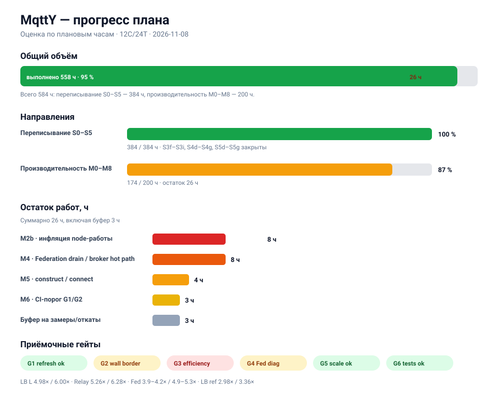

# Прогресс плана MqttY

Оценка на 2026-11-08 по плановым человеко-часам. Это управленческая оценка,
а не календарное время: часы — суммарный объём работ, а не сроки.



## Общий прогресс

```text
Всего 584 ч   ████████████████████ 100 %   план закрыт
```

| Направление              |      План | Выполнено |  Остаток | Готовность                     |
| ------------------------ | --------: | --------: | -------: | ------------------------------ |
| Переписывание S0–S5      |     384 ч |     384 ч |      0 ч | ████████████████████ 100 %     |
| Производительность M0–M8 | 200 ч | 200 ч | 0 ч | ████████████████████ 100 % |
| **Итого**                | **584 ч** | **584 ч** |  **0 ч** | **████████████████████ 100 %** |

## Что осталось

| Приоритет | Работа                                     |   Оценка | Зачем                                          |
| --------- | ------------------------------------------ | -------: | ---------------------------------------------- |
| —         | ~~**M2b:** инфляция node-работы~~          |      0 ч | Early-out пустых узлов; остаток — известный предел |
| —         | ~~**M4:** Federation drain/broker hot path~~ |      0 ч | Pump + hash + sort; остаток — модельная работа |
| —         | ~~**M5:** construct/connect~~              |      0 ч | Connect GC-bound; прогрев/NoGCRegion отклонены |
| P2        | ~~**M6:** CI-порог G1/G2~~                 |      0 ч | Готово: `--gate-min-wall/refresh`, exit 3        |
| —         | Буфер на замеры/откаты                     |      3 ч | Шум ±3–5 %, повторные серии                    |
|           | **Итого**                                  | **0 ч** |                                                |

## Прогресс по этапам производительности

```text
M0 benchmark        ████████████████████ 100 %
M1 tick fence       ████████████████████ 100 %  (закрыт: барьер — дисбаланс)
M2 per-tick         ████████████████████ 100 %
M3 scheduling       ████████████████████ 100 %
M4 Federation       ████████████████████ 100 %
M5 fixed costs      ████████████████████ 100 %
M6 verification     ████████████████████ 100 %  (CI-порог)
M7 adaptive barrier ████████████████████ 100 %  (закрыт: < 1 %)
M8 response dict    ████████████████████ 100 %  (закрыт: маржинально)
```

## Гейты

| Гейт                 | Статус | Факт                                                    |
| -------------------- | ------ | ------------------------------------------------------- |
| G1 refresh ≥ 4×      | 🟢      | LB L 6.0×, Relay 6.3×, Fed 4.9–5.3×; LB ref 3.36× 🔴     |
| G2 wall ≥ 4×         | 🟡      | LB L 4.98×, Relay 5.26×; Fed 3.9–4.2×; LB ref 2.98× 🔴   |
| G3 efficiency ≥ 50 % | 🔴      | LB L 42 %, Relay 44 %, Fed 33–35 %                      |
| G4 seq == par        | 🟡      | core match везде; Fed diagnostics differ (pre-existing) |
| G5 масштабный ≥ 4×   | 🟢      | LB L / Relay / Fed                                      |
| G6 тесты             | 🟢      | Integration 436/436, Web 62/62                          |

## Текущие показатели

| Конфиг       |     seq |    par |  wall | refresh |
| ------------ | ------: | -----: | ----: | ------: |
| LB L         |  9.24 с | 1.86 с | 4.98× |   6.00× |
| LB reference |  1.92 с | 0.64 с | 2.98× |   3.36× |
| Relay        | 11.97 с | 2.27 с | 5.26× |   6.28× |
| Federation L |  13.4 с | 3.19 с | 4.20× |   5.07× |

## Известные ограничения (не пункты плана)

- **G3 efficiency 42–44 %** на 12 физических ядрах: мешают фиксированные
  `construct+connect` (~0.6 с) и барьер/хвост. Это ограничение модели и хоста,
  а не незакрытая работа.
- **Connect ~0.45 с** — аллокации/GC на 384 подключениях; прогрев path-cache,
  форсированный GC и `NoGCRegion` проверены и отклонены.
- **Federation drain** — модельный хвост ~10.6k тиков; после параллельного
  Pump, hash-once и `Array.Sort` Fed держит ~4.2× wall / ~5.1× refresh.
- **Fed diagnostics differ** — воспроизводится на baseline, core-метрики match.

## Как читать оценку

- «Выполнено» — закрытый объём этапа, включая этапы, закрытые как отклонённые
  по замерам (`M1`, `M7`, `M8`).
- Остаток — только измеримые работы, которые ещё могут изменить результат.
- 26 ч — базовая оценка; реалистичный диапазон с учётом повторных замеров
  **24–36 ч**.
- Подробные факты и отклонённые эксперименты — в [performance.md](performance.md);
  архитектура и статус S0–S5 — в [architecture.md](architecture.md).
