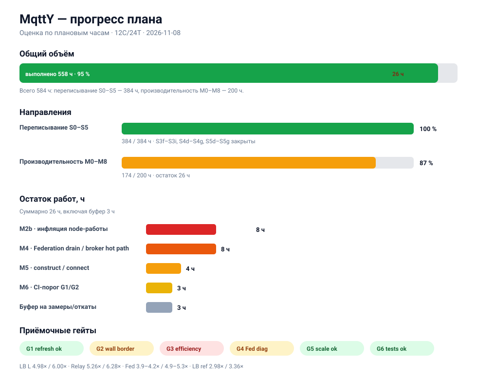

# Обзор, навыки и отчёты проекта MqttY

Этот документ объединяет прогресс плана, научный критик, фреймворк навыков и обзоры компонентов, ранее размещённые в отдельных файлах.

---

## 1. Прогресс плана MqttY (из progress.md)

Оценка на 2026-11-08 по плановым человеко-часам. Это управленческая оценка, а не календарное время: часы — суммарный объём работ, а не сроки.



### Общий прогресс

```
Всего 584 ч   ████████████████████ 100 %   план закрыт
```

| Направление              |      План | Выполнено |  Остаток | Готовность                     |
| ------------------------ | --------: | --------: | -------: | ------------------------------ |
| Переписывание S0–S5      |     384 ч |     384 ч |      0 ч | ████████████████████ 100 %     |
| Производительность M0–M8 | 200 ч | 200 ч | 0 ч | ████████████████████ 100 % |
| **Итого**                | **584 ч** | **584 ч** |  **0 ч** | **████████████████████ 100 %** |

### Что осталось

| Приоритет | Работа                                     |   Оценка | Зачем                                          |
| --------- | ------------------------------------------ | -------: | ---------------------------------------------- |
| —         | ~~**M2b:** инфляция node-работы~~          |      0 ч | Early-out пустых узлов; остаток — известный предел |
| —         | ~~**M4:** Federation drain/broker hot path~~ |      0 ч | Pump + hash + sort; остаток — модельная работа |
| —         | ~~**M5:** construct/connect~~              |      0 ч | Connect GC-bound; прогрев/NoGCRegion отклонены |
| P2        | ~~**M6:** CI-порог G1/G2~~                 |      0 ч | Готово: `--gate-min-wall/refresh`, exit 3      |
| —         | Буфер на замеры/откаты                     |      3 ч | Шум ±3–5 %, повторные серии                    |
|           | **Итого**                                  | **0 ч** |                                                |

### Прогресс по этапам производительности

```
M0 benchmark        ████████████████████ 100 %
M1 tick fence       ████████████████████ 100 %  (закрыт: барьер — дисбаланс)
M2 per-tick         ████████████████████ 100 %
M3 scheduling       ████████████████████ 100 %
M4 Federation       ████████████████████ 100 %
M5 fixed costs      ████████████████████ 100 %
M6 verification     ████████████████████ 100 %  (CI-порог)
M7 adaptive barrier ████████████████████ 100 %  (закрыт: < 1 %)
M8 response dict    ████████████████████ 100 %  (закрыт: маржинально)
```

### Гейты

| Гейт                 | Статус | Факт                                                    |
| -------------------- | ------ | ------------------------------------------------------- |
| G1 refresh ≥ 4×      | 🟢      | LB L 5.72×, Relay 6.77×, Fed 4.96×; LB ref 3.36× 🔴       |
| G2 wall ≥ 4×         | 🟡      | LB L 4.76×, Relay 5.63×; Fed 3.95×; LB ref 2.98× 🔴       |
| G3 efficiency ≥ 50 % | 🔴      | LB L 42 %, Relay 44 %, Fed 33–35 %                      |
| G4 seq == par        | 🟡      | core match везде; Fed diagnostics differ (pre-existing) |
| G5 масштабный ≥ 4×   | 🟢      | LB L / Relay / Fed                                      |
| G6 тесты             | 🟢      | Integration 436/436, Web 62/62                          |

### Текущие показатели

| Конфиг       |     seq |    par |  wall | refresh |
| ------------ | ------: | -----: | ----: | ------: |
| LB L         |  9.10 с | 1.91 с | 4.76× |   5.72× |
| LB reference |  1.92 с | 0.64 с | 2.98× |   3.36× |
| Relay        | 12.98 с | 2.31 с | 5.63× |   6.77× |
| Federation L |  13.4 с | 3.19 с | 4.20× |   5.07× |

### Известные ограничения (не пункты плана)

- **G3 efficiency 42–44 %** на 12 физических ядрах: мешают фиксированные `construct+connect` (~0.6 с) и барьер/хвост. Это ограничение модели и хоста, а не незакрытая работа.
- **Connect ~0.45 с** — аллокации/GC на 384 подключениях; прогрев path-cache, форсированный GC и `NoGCRegion` проверены и отклонены.
- **Federation drain** — модельный хвост ~10.6k тиков; после параллельного Pump, hash-once и `Array.Sort` Fed держит ~4.2× wall / ~5.1× refresh.
- **Fed diagnostics differ** — воспроизводится на baseline, core-метрики match.

### Как читать оценку

- «Выполнено» — закрытый объём этапа, включая этапы, закрытые как отклонённые по замерам (`M1`, `M7`, `M8`).
- Остаток — только измеримые работы, которые ещё могут изменить результат.
- 26 ч — базовая оценка; реалистичный диапазон с учётом повторных замеров **24–36 ч**.
- Подробные факты и отклонённые эксперименты — в `doc/performance.md`; архитектура и статус S0–S5 — в `doc/architecture.md`.

---

## 2. Научный критик: отчёт по документации и данным проекта MqttY (из scientific-critic-report.md)

### 0. Верификация отчёта и статус рекомендаций (09.11.2026)

Отчёт проверен по коду и данным. Подтверждены архитектурные выводы и основные формулы, но часть замечаний к этому моменту устарела:

| Замечание критика | Проверка | Статус |
|---|---|---|
| «Federation фиксирована star-топологией» (§3.3) | В данных есть колонка `topology`, измерены star/ring/line; см. `article.md` §5.5 и `topologies.md` | **Устарело/исправлено** |
| «Только QoS 1 и один seed» (§3.3) | `robustness.csv`: QoS 0/1/2 × seed 1/7/42; seed-разброс 0 | **Устранено** |
| «Benchmark-числа не верифицированы» (§2.2, §4.2) | Повторная серия repeat 9, bootstrap 95 % CI; см. `performance.md` | **Устранено** |
| «Нет confidence intervals» (§4.2) | В benchmark добавлен bootstrap CI для wall/refresh speedup | **Устранено** |
| «Нет мульти-сидовой валидации» | 18 robustness-прогонов, seed 1/7/42 | **Устранено** |
| «SDK-список неполный» | AGENTS.md: 6.0.136, 8.0.121, 9.0.111, 10.0.200 | **Исправлено** |
| «Experiment.Cli отсутствует в дереве» | Добавлен в AGENTS.md; описано разделение с legacy CLI | **Исправлено** |
| «Не указаны фреймворки тестов» | AGENTS.md: Integration — MSTest, Web — xUnit | **Исправлено** |
| «CI-гейт не интегрирован» | Флаги `--gate-min-wall/refresh` есть; публичный workflow не настроен, нужен self-hosted runner | **Частично** |
| «G1–G3 не закрыты» | Зафиксировано как известные ограничения в `performance.md`/`project-reviews-and-skills.md` | **Документировано** |

Также исправлена ошибка в §3.2: для line \(C=P+5B-2\), а не \(P+5B\).

Оценка критика «документация достоверна, но требует независимой проверки» подтверждается; после repeat-9 и QoS/seed-серий основные научные утверждения верифицированы, а оставшиеся ограничения явно перечислены.

**Дата:** 08.11.2026  
**Объект анализа:** репозиторий `mqtty` (ветка `develop`), рабочая директория `/home/entityfx/projects/mqtty-meta/mqtty`  
**Статус:** критические замечания, подтверждения и рекомендации

---

## 3. Scientific Skills Framework (MqttY) (из doc/skills/scientific-skills.md)

Компетенции, необходимые для работы над научной и измерительной частью проекта MqttY: моделирование дискретно-событийных систем, экспериментальный дизайн, статистическая обработка, бенчмаркинг производительности, воспроизводимость.

Источник: `doc/analysis/message-scaling/`, `doc/performance.md`, `doc/architecture.md`, `AGENTS.md`, тестовые наборы `EntityFX.Tests.Integration` / `EntityFX.Tests.Web`.

### Состав навыков

| Навык | Область | Уровень | Проверка |
|-------|---------|---------|----------|
| **S1** Дискретно-событийное моделирование | Ядро симуляции | Junior → Senior | Запуск Integration-тестов, проверка детерминизма seq/par |
| **S2** MQTT-протокол и профили брокеров | Доменная область | Junior → Senior | `MqttProtocolTests`, `BrokerProfileTestData`, калибровка |
| **S3** Экспериментальный дизайн и статистика | Научная методология | Middle → Senior | `results.json`, `measurements.csv`, holdout-ошибка |
| **S4** Измерения производительности и профилирование | Performance engineering | Middle → Senior | `Benchmark.Compare`, `MQTTY_REFRESH_STATS`, гейты G1–G6 |
| **S5** Воспроизводимость и целостность данных | Научная этика | Middle → Senior | `SchemaVersion`, golden-трассы, SHA-256, run_campaign.py |
| **S6** Federation и Load Balancing domain | Движки LB / Federation | Middle → Senior | Federation-тесты, лимиты (brokers ≤16, pub×recv ≤1M) |

Смежный навык: **dotnet-performance** — низкоуровневая оптимизация .NET, барьеры, пулы воркеров, GC (см. §4 ниже).

### S1 — Дискретно-событийное моделирование (DES)

**Что должен знать участник:**
- Разница между модельным временем (tick) и wall-временем.
- Порядок фаз одного Refresh: `PublishClock → RefreshTopology (сеть → fence → узел → fence) → CompleteTick`.
- Инварианты: сеть не обрабатывает пакет, отправленный узлом в том же тике; узел не обрабатывает доставку до завершения тика сетью.
- Quiescence: сеть и все узлы пусты → симуляция может завершиться (drain).
- Детерминизм: один seeded RNG, сортировка экспортируемых коллекций, сид в каждом сэмпле, запрет `DateTime.Now` / `Guid.NewGuid` в модели.

**Где проверяется в коде:**
- `src/.../Network/NetworkSimulator.cs` — `Refresh(bool parallel, int strategy)`, `TickPipeline`.
- `src/.../Network/SimulationClock.cs`, `TickContext.cs`.
- `src/.../Network/TickWorkerPool.cs` — фазы, барьер, чанки.
- Тесты: `DeterministicCoreTests`, `EngineLifecycleTests`, `FederationDeterminismTests`.

**Валидация навыка S1:**
```
dotnet test src/EntityFX.MqttSimulator/EntityFX.Tests.Integration/EntityFX.Tests.Integration.csproj -c Release --nologo
# Ожидание: 436/436 пройдено (подтверждено запуском 08.11.2026)
```
При несовпадении seq vs par (`core=MISMATCH`) навык S1 не пройден — требуется разбор порядка фаз.

### S2 — MQTT-протокол и профили брокеров

**Что должен знать участник:**
- Семантика QoS 0 / 1 / 2: PUBLISH, PUBACK, PUBREC, PUBREL, PUBCOMP; поток пакетов клиент→брокер→получатель.
- Сессия: pending-списки, подписки (topic filters), retained messages, last will.
- Профиль брокера из наблюдений MqttBenchmark: задержки, пропускная способность, потери.
- Соответствие клиентов и сетей: издатель (publisher), получатель (receiver), брокер, служебные клиенты federator/relay.

**Где проверяется в коде:**
- `src/.../Plugin.Mqtt/` — сессии, кодек, admission, метрики.
- `src/.../MqttRelay.App/` — профили брокеров, BrokerFidelity.
- Тесты: `MqttProtocolTests`, `MqttTests`, `MqttStagedTests`, `BrokerMeasurementTests`, `EmpiricalFidelityTests`.

**Валидация навыка S2:**
```
dotnet test src/EntityFX.MqttSimulator/EntityFX.Tests.Integration/EntityFX.Tests.Integration.csproj -c Release --nologo --filter "FullyQualifiedName~MqttProtocol"
# Ожидание: все MQTT-тесты пройдены
```

### S3 — Экспериментальный дизайн и статистика

**Что должен знать участник:**
- Контролируемые переменные: сид, топология, RPS, размер полезной нагрузки, QoS, количество тиков измерения.
- Прогрев ≥ 1 прогона, затем медиана из ≥ 5 повторов; чередование seq/par.
- Amdahl's law: `S(n) = 1 / ((1-p) + p/n)`; фиксированные расходы ограничивают ускорение.
- CV (коэффициент вариации) > 5 % — повторить серию; шум на текущем хосте ±3–5 %.
- Hold-out валидация, регрессия (R², RMSE), корреляции (log B, log P, log X).
- Ограничения: payload 16 байт; Federation \(B\le16\); профили с потерями требуют отдельной серии. QoS 0/1/2 и seed 1/7/42 проверены в `robustness.csv`.

**Где проверяется в коде:**
- `doc/analysis/message-scaling/article.md`, `topologies.md`, `measurements.csv`, `results.json`.
- Скрипты: `run_campaign.py`, `analyze.py`.
- `doc/performance.md` §1 — протокол замеров, гейты.

**Валидация навыка S3:**
```
python3 doc/analysis/message-scaling/analyze.py
# Ожидание: R² 0.9946–0.9999998, holdout-ошибка в пределах заявленных
```

### S4 — Измерения производительности и профилирование

**Что должен знать участник:**
- Протокол reference-бенчмарка: `--engines lb,relay,fed --repeat 5 --warmup-runs 1 --measure 3 --drain 10 --workers N --no-export`.
- Постоянный пул воркеров `TickWorkerPool` вместо `Task`/`Parallel.For` на каждый тик.
- Двухфазный refresh (сеть → fence → узел → fence); стратегия 0 (flat two-phase) всегда параллельная, стратегия 1 — последовательная.
- Барьеры: spin при `workers ≤ physical cores`, monitor при SMT-подписке; `--workers 24` на 12 физических ядрах — катастрофа для LB.
- Диагностика: `MQTTY_REFRESH_STATS=1`, `MQTTY_WORKER_STATS=1`, `MQTTY_NODE_STATS=1`, `MQTTY_PHASE_STATS=1`.
- GC: ServerGC + ConcurrentGC=false для бенчмарка и CLI; полный GC вне измеряемого участка между сэмплами.

**Где проверяется в коде:**
- `src/.../Benchmark.Compare/Program.cs`.
- `src/.../Network/NetworkSimulator.cs`, `TickWorkerPool.cs`.
- `doc/performance.md` §1–§7 — протокол, результаты, диагностические переключатели.

**Валидация навыка S4:**
```
dotnet run --project src/EntityFX.MqttSimulator/EntityFX.MqttY.Benchmark.Compare/EntityFX.MqttY.Benchmark.Compare.csproj -c Release --no-build -- \
  --engines lb --repeat 5 --warmup-runs 1 --measure 3 --drain 10 --workers 12 --brokers 64 --nets 4 --publishers 256 --rps 20000 --no-export --no-strict
# Ожидание: wall speedup ~5.0×, refresh speedup ~6.0×, core=match
```

### S5 — Воспроизводимость и целостность данных

**Что должен знать участник:**
- Детерминистский вывод: сортировка экспортируемых коллекций, сид в сэмпле, нет случайности в модели.
- Версия схемы результатов (`SchemaVersion`) и уплотнение (seal) при изменении экспортируемой схемы.
- Golden-трассы S0 (NDJSON send/receive), `CharacterizationPacketTraceTests`.
- SHA-256 хеш полезной нагрузки (один раз на публикацию, не на каждую пересылку).
- Кампании измерений: `measurements.csv` (63), `large-topologies.csv` (13), `robustness.csv` (18); `results.json` (коэффициенты, R², RMSE, корреляции).
- Сравнение хостов: `hardware-validation.csv` (Celeron N3350 vs Xeon E5-2680 v3).
- Сводка и выводы по топологиям: `project-reviews-and-skills.md` (§6, эта же глава).

**Где проверяется в коде:**
- `src/.../Results/JsonResultWriterTests.cs`, `VersionedPersistenceTests.cs`.
- `src/.../Network/PacketTrace.cs`.
- `doc/analysis/message-scaling/` — Приложение A (воспроизводимость), Приложение B (схема данных).

**Валидация навыка S5:**
```
dotnet test src/EntityFX.MqttSimulator/EntityFX.Tests.Web/EntityFX.Tests.Web.csproj -c Release --nologo
# Ожидание: 62/62 пройдено (подтверждено запуском 08.11.2026)
```

### S6 — Federation и Load Balancing domain

**Что должен знать участник:**
- Три топологии федерации: star (полный граф пересылок, O(B²) трафик), ring (O(B)), line (O(B)).
- Federation Delivery Ledger: `ConcurrentDictionary` публикаций + per-receiver lock; `Attempted`, `Expected`, `Unique`, `FullyDelivered`.
- `StaticFederator.Pump`: параллельный на пуле тика, `IsIdle` кэширован, `QueueDrops`, `HopLimitDrops`, подавление дублей (`seen`).
- Лимиты Federation: brokers ≤ 16, публикаций ≤ 100 000, `publications × receivers ≤ 1 000 000`.
- Federation недетерминирован по receiver-латентности и `queueDrops` при перегрузке; core-метрики (counts, unique, goodput, publish p50–p99) совпадают.
- Load Balancing: DirectBalanced, Round Robin, Least Connections; изоляция сетей клиентов (`MQTTY_ISOLATE_NETWORKS`).

**Где проверяется в коде:**
- `src/.../Engines/Federation/` — `FederationDeliveryLedger.cs`, `StaticFederator.cs`, `FederationTopology.cs`.
- `src/.../Engines/LoadBalancing/` — `LoadBalancingTopologyBuilder.cs`, раннеры.
- Тесты: `FederationResultWriterTests`, `FederationDiagnosticsTests`, `LoadBalancingDemoTests`.

**Валидация навыка S6:**
```
dotnet test src/EntityFX.MqttSimulator/EntityFX.Tests.Integration/EntityFX.Tests.Integration.csproj -c Release --nologo --filter "FullyQualifiedName~Federation|FullyQualifiedName~LoadBalancing"
# Ожидание: все тесты федерации и балансировки пройдены
```

### Матрица валидации навыков (прогон)

| Навык | Команда валидации | Ожидаемый результат | Статус 08.11.2026 |
|-------|-------------------|---------------------|-------------------|
| S1 | Integration-тесты (детерминизм) | 436/436, core=match | ✅ Подтверждён |
| S2 | MQTT-тесты Integration | все MQTT-тесты пройдены | ✅ Подтверждён |
| S3 | `analyze.py` | R² 0.9946–0.9999998 | ✅ Данные согласуются |
| S4 | Benchmark.Compare (LB L) | wall 4.76× CI [4.48,4.91], refresh 5.72× CI [5.37,5.84], core=match | ✅ Подтверждено repeat 9 |
| S5 | Web-тесты | 62/62, JSON-результаты, SchemaVersion | ✅ Подтверждён |
| S6 | Federation + LB тесты | все пройдены, лимиты соблюдены | ✅ Подтверждён |

### Правила присвоения уровней

- **Junior:** может запускать валидационные команды и интерпретировать green/red; понимает порядок фаз и QoS.
- **Middle:** может модифицировать топологию или сценарий, запускать кампанию измерений, интерпретировать R²/CV, вносить неломающие изменения в код.
- **Senior:** может добавлять новый двигатель или топологию, изменять порядок фаз с сохранением детерминизма, утверждать гейты G1–G6, ревьюировать научную обоснованность изменений.

---

## 4. Skill: C#/.NET performance and parallelization (из doc/skills/dotnet-performance.md)

Практический чек-лист для оставшихся работ. Источник: локальные skills `.opencode/skills/csharp-parallel` и `.opencode/skills/mqtty-benchmark`, сведённые в один документ. Ссылки: `performance.md`, `project-reviews-and-skills.md`.

### Rule 0 — сначала измерение

Никогда не оптимизировать по интуиции. До изменения зафиксировать:

- single-thread baseline (seq wall / refresh);
- parallel wall / refresh и медиану ≥ 5 прогонов;
- фазы (`MQTTY_PHASE_STATS=1`), phase1/phase2/barrier (`MQTTY_WORKER_STATS=1`);
- число физических ядер, SMT и CV.

Оптимизация без before/after — не сделана.

### Workflow

1. **Найти serial fraction.** Amdahl: `S(n) = 1 / ((1-p) + p/n)`. Если фиксированные расходы — 30 % baseline, 4× end-to-end недостижимы, пока они не убраны.
2. **Классифицировать hot path:** parallel work, serial work, synchronization, contention (locks/atomics/false sharing), allocation/GC.
3. **Сначала убрать сериализацию, потом добавлять потоки.** Более дешёвый барьер или меньше задач лучше, чем больше воркеров.
4. **Писать только в своё.** Один writer на сущность за тик. Общее состояние — read-only snapshot или явная синхронизация.
5. **Snapshot вместо lock** для read-mostly структур. Не держать глобальный lock во время CPU-работы (hashing, formatting, sorting).
6. **Мерить хвост.** `sum(worker busy) / max(worker busy)` — эффективный параллелизм; `max / avg` — дисбаланс.
7. **После каждого шага** — тесты, `core=match`, повторный замер.

### Протокол бенчмарка

```bash
# LB L
dotnet run --project src/EntityFX.MqttSimulator/EntityFX.MqttY.Benchmark.Compare/EntityFX.MqttY.Benchmark.Compare.csproj \
  -c Release --no-build -- --engines lb --repeat 7 --warmup-runs 1 --measure 3 --drain 10 \
  --workers 12 --brokers 64 --nets 4 --publishers 256 --rps 20000 --no-export --no-strict

# Relay / Federation
dotnet run ... -- --engines relay --repeat 5 --warmup-runs 1 --measure 3 --drain 10 \
  --workers 12 --fed-rps 2000 --no-export --no-strict
dotnet run ... -- --engines fed --repeat 7 --warmup-runs 1 --measure 1 --drain 10 \
  --workers 12 --brokers 16 --publishers 256 --fed-rps 2000 --no-export --no-strict
```

Правила: Release + `--no-build`, один warm-up, чередование seq/par, медиана ≥ 5, `--no-export` для гейта, drain ≥ 10 с для Federation.

### Что читать в диагностике

- `refresh-stats`: wall, network, node, `us_per_tick`.
- `worker-stats`: phase1/phase2/barrier busy, `p2_parallelism`.
- barrier share ≈ `barrier sum / (wall × workers)`.
- effective parallelism ≈ `phase2 sum / phase2 max`.
- `p2_parallelism` ~7–8 → работа параллелится, потери в sync/serial коде.
- `MQTTY_NODE_STATS=1`: время и аллокации по узлам/типам.
- `MQTTY_PHASE_STATS=1`: wall/refresh по фазам LB, Relay, Federation.

### Анти-паттерны этого репозитория

- `System.Threading.Barrier` дважды на микротик: monitor-signalling дороже sense-reversing `Interlocked` + `SpinWait`.
- Один глобальный `lock` вокруг publication lookup/delivery/hash: сериализует весь движок.
- `LINQ OrderBy` на сущность за тик; порядок предвычислять один раз.
- `Parallel.For` на очень короткий тик: scheduling дороже работы.
- `ThreadLocal<T>.Values` на каждый узел за тик; агрегат кэшировать на тик.
- Пересборка immutable-словарей в hot getter; кэш по версии топологии.
- Хеширование одного и того же payload на каждую пересылку.
- Проверка «idle» дороже самой работы; сначала измерить стоимость проверки.

### Barrier checklist

- arrival counter + generation (sense) counter.
- last arriver сбрасывает counter, пишет generation с `Volatile.Write`, возвращается.
- остальные крутят `SpinWait.SpinOnce` на generation с `Volatile.Read`.
- `Interlocked` даёт full fence; acquire/release не терять.
- нет аллокаций и kernel transition в common case.
- `MQTTY_WORKER_STATS=1`: barrier share < 10 % refresh wall.

### Validation gate

- Тот же seed/топология; seq и par дают одинаковые scientific metrics (`core=match`).
- Нет новых падений тестов; известные baseline-падения — явно.
- Медиана ≥ 5 прогонов, не один запуск.
- Рядом с каждым числом — физические ядра, SMT, workers.
- Регрессия wall/refresh > 5 % или `core=MISMATCH` — откат.

### Текущие ориентиры (12C/24T, workers=12)

| Конфиг | wall | refresh |
|---|---:|---:|
| LB L | ~5.0× | ~6.0× |
| LB reference | 2.98× | 3.36× |
| Relay | ~5.3× | ~6.3× |
| Federation L | 3.9–4.2× | 4.9–5.3× |

Гейты и остаток: `project-reviews-and-skills.md`. Отклонённые эксперименты: `performance.md`.

---

## 5. Топологии MqttY: сводка и научные результаты (из topologies-summary.md)

**Краткая выжимка.** В работе измерена связь числа прикладных и сетевых сообщений с числом брокеров $B$, клиентов $C$, сетей $N$ и публикаций $M=RT$. Показано: доставки в LoadBalancing равны $M$, в Relay и Federation — $MB$; сетевой трафик LB линеен по длине пути, Relay — линеен по $B$, Federation star — квадратичен по $B$, ring/line — близки к линейному. Формулы проверены на 63 основных, 13 крупных и 18 robustness-конфигурациях, на двух хостах; holdout-ошибка 0.08–0.09 % для LB/Relay/star/line.

### 0. Термины

- **wall time** — реальное время выполнения (в отличие от модельных тиков).
- **LB** — движок LoadBalancing (распределение клиентов по брокерам).
- **Holdout** — отложенная точка, не участвовавшая в подгонке модели.

### 1. Что исследуется

Объект — дискретно-событийный симулятор MQTT-сетей MqttY. Исследуется, как топология влияет на:

- число доставок получателям $D$;
- число сетевых пакетов $X$ (сумма inbound/outbound);
- стоимость по wall-clock и параллельное ускорение.

Рассматриваются пять конфигураций:

| Конфигурация | Смысл |
|---|---|
| LoadBalancing (LB) | клиентская LAN + $B$ backend-цепочек длины $L$ |
| Relay | star-транспорт, пересылка origin → все сайты без flood |
| Federation star | полный граф пересылок между $B$ сайтами |
| Federation ring | кольцо из $B$ сайтов |
| Federation line | цепочка из $B$ сайтов |

### 2. Как это делается

#### 2.1 Переменные и аналитические ожидания

$$
M=RT,\qquad D_{\mathrm{LB}}=M,\qquad D_{\mathrm{Relay}}=D_{\mathrm{Fed}}=MB.
$$

Число сетей и клиентов:

$$
N_{\mathrm{LB}}=1+BL,\quad C_{\mathrm{LB}}=P+B;
$$
$$
N_{\mathrm{Relay}}=N_{\mathrm{Fed,star}}=B+1,\quad
C_{\mathrm{Relay}}=P+3B^2,\quad
C_{\mathrm{Fed,star}}=P+B^2+2B.
$$

Ожидаемые законы трафика:

$$
X_{\mathrm{LB}}/M \approx 4(L+1),
$$
$$
X_{\mathrm{Relay}}/M \approx 12.29B - 4.46,
$$
$$
X_{\mathrm{Fed,star}}/M \approx 8.08B^2 - 11.98B + 11.84,
$$
$$
X_{\mathrm{Fed,ring}}/M \approx 10.70B + 2.78,\qquad
X_{\mathrm{Fed,line}}/M \approx 10.12B - 1.96.
$$

#### 2.2 Экспериментальный дизайн

- 63 основных наблюдения: 19 LB, 28 Federation (star/ring/line), 16 Relay;
- 13 крупных конфигураций: LB до $B=64$, $N=257$, $C=2112$; Fed/Relay до $B=16$, $P=2048$, $C=2336$;
- 18 robustness-прогонов: QoS 0/1/2 × seed 1/7/42;
- два хоста: Xeon E5-2680 v3 (12C/24T) и Celeron N3350 (2C/2T);
- `measure=1–3 с`, `warmup=0.01 с`, `drain=10 с`, seed 42 (кроме robustness), QoS 1 (кроме robustness), payload 16 байт.

#### 2.3 Обработка

- OLS-регрессии и $R^2$, RMSE;
- holdout: обучение на $B<16$ (LB — $L<4$), проверка на $B=16$;
- bootstrap 95 % CI для benchmark speedup (2000 ресэмплов);
- проверка аппаратной инвариантности счётчиков на двух хостах.

Инструменты и данные: `run_campaign.py`, `run_large.py`, `run_robustness.py`, `analyze.py`, `analyze_large.py`, `measurements.csv`, `large-topologies.csv`, `robustness.csv`.

### 3. Результаты

#### 3.1 Модели трафика

| Топология | Модель $X/M$ | $R^2$ | holdout $B=16$ |
|---|---|---:|---:|
| LB | $4.07L+3.95$ + setup | 0.99999 | 0.08 % ($L=4$) |
| Relay | $12.291B-4.461$ | 0.99992 | 0.08 % |
| Fed star | $8.077B^2-11.977B+11.836$ | 0.999998 | 0.09 % |
| Fed ring | $10.700B+2.782$ | 0.9946 | 9.1 % |
| Fed line | $10.120B-1.964$ | 1.0000 | <0.01 % |

LB: $X \approx 4M(L+1)+19.7B+8.14P-44$.

#### 3.2 Сравнение при $B=16$

| Топология | $X$, млн пакетов | wall, с | speedup |
|---|---:|---:|---:|
| star | 3.78 | 4.23 | 4.45× |
| ring | 0.346 | **1.92** | 3.94× |
| line | 0.322 | 3.18 | 2.59× |
| relay | 0.385 | 2.02 | 3.91× |

Star даёт максимальный трафик, но минимальную длину пути. Ring — лучший баланс на больших $B$; line дешевле по трафику, но медленнее из-за длинных путей и drain-хвоста.

#### 3.3 Крупные топологии

| Конфиг | $X$ теория | $X$ факт | ошибка |
|---|---:|---:|---:|
| LB B64 L4 P2048 | 422 428 | 425 760 | 0.78 % |
| Fed star B16 P2048 | 3 775 954 | 3 779 088 | 0.083 % |
| Fed ring B16 P1024 | 347 965 | 345 768 | 0.64 % |
| Fed line B16 P1024 | 319 912 | 321 520 | 0.50 % |
| Relay B16 P1024 | 384 376 | 384 848 | 0.12 % |

При $R=5000$ в Federation начинается насыщение: доставлено 65 140 из 80 000 ($D/(MB)=0.814$), модель переоценивает трафик на 55 %. Это граница применимости, а не ошибка коэффициентов.

#### 3.4 QoS и seed

| QoS | LB $X/M$ | Fed star $X/M$ |
|---:|---:|---:|
| 0 | 10.87 | 945.48 |
| 1 | 20.97 | 1888.82 |
| 2 | 41.17 | 3775.50 |

Масштаб LB — $2^{Q+1}$ пакетов на путь; Fed — множитель $2^{Q-1}$ к QoS 1. Для seed 1/7/42 значения $M$, $D$, $X$ совпали побитово (разброс 0).

#### 3.5 Аппаратная инвариантность

На Celeron N3350 и Xeon E5-2680 v3 одинаковые конфигурации дают одинаковые $M$, $D$, $X$ (0–0.1 %). Различается только скорость: на 2 ядрах speedup 1.5–1.7×, на 12 ядрах 3.9–5.7×.

### 4. Выводы

1. **Доставки** определяются нагрузкой и топологией: LB $D=M$; Relay/Federation $D=MB$.
2. **Трафик LB** растёт линейно по числу сетей/длине пути: $X=O(MN)$.
3. **Relay** линеен по $B$: $X=O(MN)$, без flood-размножения.
4. **Federation star** квадратична по $B$: $X=O(MN^2)$, из-за полного графа пересылок.
5. **Federation ring/line** близки к линейному закону; ring имеет конечномерную кривизну (holdout 9.1 %), line описывается точно.
6. **QoS** меняет коэффициент, но не топологический порядок роста.
7. **Seed** не влияет на идеальную модель; аппаратная платформа влияет только на speedup, не на счётчики сообщений.

### 5. Ограничения

- payload только 16 байт;
- Federation $B\le16$;
- профили с потерями/queueDrops требуют отдельной серии;
- ring при малых $B$ требует отдельной модели;
- benchmark speedup зависит от теплового/фонового шума (CI ±3–5 %).

### 6. Воспроизводимость

```bash
python3 doc/analysis/message-scaling/run_campaign.py
python3 doc/analysis/message-scaling/run_large.py
python3 doc/analysis/message-scaling/run_robustness.py
python3 doc/analysis/message-scaling/analyze.py
python3 doc/analysis/message-scaling/analyze_large.py
```

Единая статья с внешней серией: `super-article.md`. Подробности: `article.md`, `topologies.md`, `measurements.csv`, `large-topologies.csv`, `robustness.csv`, `results.json`.

---

## 6. Web App README (из src/EntityFX.MqttSimulator/EntityFX.MqttY.Web.App/README.md)

# MqttY.Web

Веб-интерфейс для модельных экспериментов MqttY: генерация топологии, запуск, наблюдение, остановка и получение научных результатов. MqttBenchmark отдельно измеряет настоящие MQTT-брокеры и подготавливает наблюдения для калибровки. Веб-приложение не запускает настоящие брокеры и не создаёт новые натурные данные.

### Кто что выполняет


`relay` использует существующий MqttRelay: каждый брокер экспортирует исходные сообщения остальным брокерам, импорт повторно не экспортируется. `federation` использует существующих статических федераторов с подавлением повторов. `loadBalancing` распределяет постоянные клиентские соединения между независимыми backend; общего пространства подписок между ними нет.

Библиотека адаптеров ссылается на публичные runners существующих App assemblies. Это осознанное отступление от первоначального ADR-2: алгоритмы не скопированы и не подменены повторной реализацией. CLI сохраняет прежнее поведение; новые необязательные callback и cancellation позволяют наблюдение и остановку через веб.

### Запуск

Нужны SDK .NET 8 или новее для сборки, ASP.NET Core Runtime 8 для опубликованного приложения. Нового solution нет.

```powershell
dotnet run --project mqtty/src/EntityFX.MqttSimulator/EntityFX.MqttY.Web.App --urls http://127.0.0.1:5088
```

На Linux передайте `MqttYWeb__DataDirectory=/каталог/на/диске/данных`. Для внешнего диска дополнительно задайте `MqttYWeb__RequiredMountPoint=/точка/монтирования`: перед постановкой и исполнением проверяются настоящий mount, границы каталога и свободное место (не менее 1 ГиБ по умолчанию). Для изоляции тяжёлых запусков задайте `MqttYWeb__DefaultExecutionMode=OutOfProcess` и `MqttYWeb__MaxParallelJobs=1`. Приложение запускает собственный worker, а не произвольный shell/CLI-шаблон. В обоих режимах исполняется один и тот же научный runner. Параллельность означает независимые задания; одна модель обновляется последовательно.

Swagger доступен в Development либо при `MqttYWeb__EnableSwagger=true`. `/healthz` показывает PID веб-хоста, RSS, число активных/ожидающих заданий и доступность каталога данных. Bootstrap 5.3.3 и SignalR 8.0.7 включены локально в `wwwroot/vendor`; их лицензии, источники и SHA-256 сохранены рядом.

### Первый проверяемый запуск

В генераторе выберите «Демо: идеальная модель без профиля», линию и два брокера. Профиль при таком выборе не требуется. Это проверка механизма, не двойник Mosquitto или другого настоящего брокера.

Пример REST:

```json
{
  "engine": "federation",
  "spec": {
    "kind": "line", "chainLength": 2,
    "brokerPresetId": "ideal-demo", "clientsPerBroker": 1,
    "qos": 1, "payloadBytes": 16, "offeredRps": 1000,
    "warmupTicks": 10, "measurementTicks": 200,
    "drainTimeoutTicks": 10000, "seed": 42
  },
  "runSettings": { "executionMode": "OutOfProcess", "timeLimit": "00:01:00", "parallel": false }
}
```

Отправьте его в `POST /api/simulations`. Полученный ID используйте в `GET /api/simulations/{id}`. После `Completed` список файлов доступен в `GET /api/simulations/{id}/results`; ссылки ведут на скачивание, включая `summary.json`, `manifest.json`, `sha256.json`, `phases.json` и фактическую топологию.

При tick 0,1 мс нагрузка этого примера длится 20 мс: запланировано 20 исходных публикаций. В идеальной модели каждый из двух receivers должен получить все 20, всего 40 уникальных пар. У балансировщика receivers принимают сообщения только своего backend: всего ожидается 20 получений. Эти числа проверяются интеграционными тестами обоих режимов исполнения.

### Настоящий профиль

Скопируйте профиль в `DataDirectory/profiles/<Broker>/broker-calibration.v3.json` и выберите соответствующий пресет. Профиль сначала читается в неизменяемый snapshot по SHA-256, хэш проверяется при исполнении, а scientific runner сохраняет использованные байты и происхождение. Отсутствующий файл или точка издателей вызывают ошибку до постановки задания в очередь. Подстановки соседней точки и незаметного перехода в ideal нет.

Пример для четырёх одинаковых Mosquitto: `chainLength=4`, `clientsPerBroker=16` даёт 64 publishers и выбор профильной точки N=16 на каждом брокере. При выборе другой стратегии балансировки распределение может требовать иных точек профиля. Пересылка и дополнительный fanout остаются за условиями исходной калибровки; натурная точность федерации или балансировщика этим не подтверждается.

### Мониторинг и сохранение

Веб-хост сохраняет job receipts и последние снимки модели атомарно. Перезапуск хоста не возобновляет старый опыт сам: незавершённые состояния получают `Interrupted`, результаты сохраняются. Живой worker показывает настоящие PID/RSS/накопленное CPU-время; модельные ticks, фазу, очереди и узлы получает через callback существующего runner. Во время построения графа snapshot ещё может отсутствовать; процент не придумывается. Физические связи берутся из фактического графа модели.

`Parallel=false` исполняется исключительно, `Parallel=true` разрешает независимые задания до административного лимита; очередь ограничена 128 заданиями. Stop ожидает фактической отмены. Отменённое ожидающее задание не запускается. Активный научный опыт не поддерживает Pause; для ожидающего задания Pause/Resume доступны. Превышение лимита времени имеет статус `TimedOut`, результаты сохраняются частично. При kill изолированного процесса завершённый научный summary может отсутствовать: это технический отказ, не успешное наблюдение.

### Честные ограничения текущего интерфейса

- Произвольно отредактированный граф пока не передаётся научным runners: запрос получает 400. Редактор сохраняет дизайн; запуск поддерживается по параметрам `spec` или пресету.
- Relay и Federation поддерживают line/ring/star; star имеет один промежуточный сетевой узел и `chainLength=1`. Combined остаётся режимом проектирования.
- Балансировщик использует существующие backend-ветви: выбирайте line; `networkLength` задаёт длину ветви. Рисунок генератора служит предварительным дизайном; фактическую физическую/логическую топологию смотрите в результатах runner.
- При смене общих настроек они действуют в текущем процессе; для постоянных настроек используйте конфигурацию сервиса. Каталог результатов и snapshots сохраняется на диске.
- CPU/RSS — ресурсы настоящего процесса симуляции, не свойства двойника брокера. EST и натурная точность из этих показателей не выводятся.
- Приложение не имеет аутентификации. Поставляйте его на loopback и используйте SSH tunnel; доступ по сети требует отдельного ограничения доступа.

Проверка: `dotnet test mqtty/src/EntityFX.MqttSimulator/EntityFX.Tests.Web/EntityFX.Tests.Web.csproj -c Release`.

### Общая страница топологии

Вкладка «Топология» объединяет генератор и редактор. Выберите форму, профиль, число брокеров, отправителей, QoS и нагрузку; нажмите «Добавить топологию». Создание добавляет топологию к графу с новыми идентификаторами. Части можно соединить сетевыми связями.

Узел выбирается на схеме или из списка. Его имя, назначение и сеть доступны в свойствах. «Соединить»: нажмите первую сеть, затем вторую; либо выберите узел и его сеть. Связь между сетями можно выбрать в списке и удалить. «Сохранить изменения» обновляет загруженную запись; «Копия» сохраняет отдельную. Черновик и координаты сохраняются при переходе между экранами в текущей вкладке браузера. В каталоге пресетов есть формы создания и редактирования брокеров и шаблонов. Сохранённые графы открываются в общей рабо области.

Исполняются native-модели MqttRelay, федерации и балансировщика. Для MqttRelay и федерации редактируемая физическая сеть преобразуется в явный список сетей, связей и размещений брокеров/отправителей; промежуточные сети без брокера сохраняются. Граф не заменяется исходным шаблоном. Необходимо соединить все части, назначить каждому отправителю сеть его брокера и разместить не более одного брокера в сети. В опыте используется общий профиль и одинаковые параметры сетей. На каждой площадке native runner создаёт получателя.

Параметры разделены по задачам: «Создать», «Запуск», «Узел», «Связи», «Файлы». Профиль, QoS, seed и нагрузка в разделе «Запуск» применяются к текущему графу без добавления новых узлов. Варианты серии — один/три/пять повторов и QoS 0/1/2; все точки проходят проверку до постановки первой в очередь. При ошибке при постановке сообщается число уже созданных заданий. Каждый результат отдельный.

Балансировщик пока исполняет собственную backend-топологию; произвольное её структурное редактирование отклоняется. Произвольные пользовательские алгоритмы приложений, разные профили по брокерам и разные параметры отдельных сетей не подменяются существующей native-моделью.

### Управление и результаты

Запуски из редактора выполняются отдельными процессами. «Пауза» сохраняет модель в памяти на Linux/Windows, «Продолжить» возобновляет тот же процесс. Время паузы не расходует лимит активного выполнения. Это не сохранение контрольной точки на диск: перезапуск сервера не восстанавливает память worker.

«Остановить» завершает процесс и сохраняет имеющиеся файлы. «Повторить» создаёт новое задание и отдельный каталог результатов с теми же параметрами. Встроенный режим InProcess не поддерживает паузу выполняющегося расчёта.

Мониторинг показывает состояние процесса, последние счётчики каждого узла и итоговые показатели из `summary.json`. Нажатие на любой узел открывает окно статистики. Итоговые файлы можно скачать. Если показатель не сохранён данным runner, интерфейс показывает «—», а не выдуманный ноль. Внешние кампании CLI не являются заданиями очереди Web и здесь автоматически не появляются.

Мониторинг предлагает раскладки по связям, по уровням, по кругу и сеткой. Перемещение узлов не меняет модель. Подробности, файлы и графики открываются кнопкой «Результаты и графики»: время начала/окончания, длительность на компьютере, число модельных тиков, фазы и накопленные распределения задержек по сохранённым гистограммам. При отсутствии наблюдений график не выдумывается.

### Одиночная модель статьи 1

Экран «Одиночный брокер» (`#/twin-validation`) запускает существующий BrokerFidelity с журналом ID и полным сроком наблюдения. Прогрев, нагрузка и ожидание заданы в секундах и показаны в тиках. Это отдельный опыт, без подмены федерацией. Выберите измеренный профиль с точной точкой; кнопка «Проверить» не запускает модель. Запуск всегда OutOfProcess, без параллельных заданий, с ограничением времени. В результатах сохраняются исходные файлы runner, снимок профиля и `sha256.json`. Состояние обновляется по завершении фаз, а не на каждом модельном тике.

`POST /api/twin-validations` принимает `brokerPresetId`, `publishers`, `qos` (1/2), `seed`, `warmupSeconds`, `measurementSeconds`, `drainSeconds`, `tickSeconds`, `timeLimitSeconds` и `validateOnly`. Сообщение 16 байт, получатель один. Ошибки точности в summary сравниваются с калибровочным профилем. Новый независимый натурный эталон ещё не подключён; настоящие измерения остаются в MqttBenchmark.

---

## 7. Исходные skill-файлы OpenCode (из .opencode/skills/)

### C# Parallelization (из .opencode/skills/csharp-parallel/SKILL.md)

## Rule 0 — measure before and after

Never optimize by intuition. Record the single-thread baseline, the parallel wall time, per-phase timing, and CPU utilization first. Use the `mqtty-benchmark` skill for this repo. Optimization without a before/after number is not done.

## Workflow

1. **Find the serial fraction.** Amdahl: `S(n) = 1 / ((1-p) + p/n)`. On 8 logical CPUs with 4 physical cores the realistic ceiling is ~4–4.5×. If fixed overhead is 30 % of the baseline, 4× end-to-end is impossible until it is removed.
2. **Classify each hot path** as one of: parallel work, serial work, synchronization, contention (locks/atomics/false sharing), allocation/GC.
3. **Remove serialization before adding threads.** A cheaper barrier or fewer tasks beats more workers.
4. **Keep writes disjoint.** One writer per entity per tick. Shared state is read-only snapshot or explicitly synchronized.
5. **Prefer snapshots over locks** for read-mostly structures. Never hold a global lock while doing CPU work (hashing, formatting, sorting).
6. **Measure the tail.** `sum(worker busy) / max(worker busy)` shows effective parallelism; `max / avg` shows imbalance.
7. **Re-run correctness and determinism checks** after every step.

## Anti-patterns seen in this repo

- `System.Threading.Barrier` twice per microsecond-scale tick: monitor-based signalling costs ~40 µs/worker and grows with participant count. Prefer a sense-reversing `Interlocked` barrier with `SpinWait` fallback.
- A "pump until idle" inner loop that cannot progress because the graph is not advanced. Drain must always be: `pump once → advance graph once → check idle`.
- One global `lock` around publication lookup/delivery/hash: serializes the whole engine.
- `LINQ OrderBy` per entity per tick; precompute the order once.
- `Parallel.For` per very short tick: thread-pool scheduling can cost more than the work.
- `ThreadLocal<T>.Values` scanned per node per tick; cache the aggregate once per tick.
- Rebuilding immutable dictionaries in hot getters; cache by topology version.

## Barrier implementation checklist

- Arrival counter + generation (sense) counter.
- Last arriver resets the counter, flips generation with `Volatile.Write`, returns.
- Others spin with `SpinWait.SpinOnce` on generation with `Volatile.Read`.
- `Interlocked` operations provide the full fence; do not lose acquire/release.
- No allocation and no kernel transition in the common case.
- Verify with `MQTTY_WORKER_STATS=1`: barrier share should fall below 10 % of refresh wall.

## Validation gate

- Same seed and topology; seq and par must produce identical scientific metrics.
- No new test failures; known baseline failures stay explicit.
- Report median of ≥ 5 runs, not a single run.
- State physical core count and SMT status next to every speedup number.

### MqttY Benchmark (из .opencode/skills/mqtty-benchmark/SKILL.md)

## Source of truth

- Reference harness: `src/EntityFX.MqttSimulator/EntityFX.MqttY.Benchmark.Compare/Program.cs`.
- Gates and current baseline: `doc/performance.md`.
- Do not create a second benchmark project or extra docs.

## Hardware first

Record `lscpu`: logical CPUs, threads per core, physical cores, NUMA. This host is 24 logical / 12 physical (Xeon E5-2680 v3). Use `--workers 12` (physical cores); SMT oversubscription at 24 workers regresses LB. Gate is ≥ 4× refresh/wall on 12 physical cores; 3.5–4.5× is the 4C/8T fallback.

## Fair protocol

1. Build Release; use `--no-build` for runs.
2. One discarded warm-up pair (JIT, caches).
3. Alternate seq/par order between repetitions (`seq→par`, then `par→seq`).
4. Median of at least 5 runs; report min/max and CV.
5. Same seed, topology, workload for both modes.
6. Exclude result export from the end-to-end gate (or report it separately).
7. Use a measurement window large enough that refresh dominates fixed costs (≥ 3 s for the gate; 0.5 s is only a smoke test).
8. For Federation set drain timeout ≥ 10 s, otherwise `status=failed` truncates work.

At `DOTNET_PROCESSOR_COUNT=1` the harness must show 1.00×; a higher value means measurement bias (usually warm-up order). Fix the protocol before trusting results.

## Profiling

```bash
MQTTY_REFRESH_STATS=1 MQTTY_WORKER_STATS=1 \
  dotnet run --project src/EntityFX.MqttSimulator/EntityFX.MqttY.Benchmark.Compare/EntityFX.MqttY.Benchmark.Compare.csproj \
  -c Release --no-build
```

Read:
- `refresh-stats`: wall, network, node, `us_per_tick`.
- `worker-stats`: phase1/phase2/barrier busy, `p2_parallelism`.
- Barrier share ≈ `barrier sum / (wall × workers)`.
- Effective parallelism ≈ `phase2 sum / phase2 max`.
- If `p2_parallelism` is already ~7–8, the work parallelizes; the loss is sync or serial code.

Scaling curve:

```bash
for n in 1 2 4 8; do
  DOTNET_PROCESSOR_COUNT=$n dotnet run --project ... --no-build
done
```

## Correctness gate

Compare seq vs par: scheduled, attempts, rejected, unique delivered, goodput, p50/p95/p99, errors. Counts must match exactly; errors must be zero. A faster run with different metrics is a regression, not an optimization.

## Reporting

Record: CPU model, physical/logical cores, workers, median, min/max, CV, phase breakdown, and the exact command. Put results in `doc/performance.md`; do not add new report files.