# MqttY.Web

Веб-интерфейс для модельных экспериментов MqttY: генерация топологии, запуск, наблюдение, остановка и получение научных результатов. MqttBenchmark отдельно измеряет настоящие MQTT-брокеры и подготавливает наблюдения для калибровки. Веб-приложение не запускает настоящие брокеры и не создаёт новые натурные данные.

## Кто что выполняет

```mermaid
flowchart LR
    B[Настоящий брокер] <-->|MQTT нагрузка и доставки| MB[MqttBenchmark]
    MB --> O[Наблюдения и проверка исходных данных]
    O --> C[Калибратор MqttY]
    C --> P[Профиль брокера: JSON и SHA-256]
    U[Браузер] --> W[MqttY.Web: API, очередь, мониторинг]
    P --> W
    W --> E[EntityFX.MqttY.Engines: адаптеры]
    E --> F[Проверенные FederationRunner / LoadBalancingExperimentRunner]
    F --> M[Ядро MqttY: MQTT, брокеры и модельная сеть]
    M --> R[Summary, raw, гистограммы, графы и SHA-256]
    R --> U
```



`relay` использует существующий MqttRelay: каждый брокер экспортирует исходные сообщения остальным брокерам, импорт повторно не экспортируется. `federation` использует существующих статических федераторов с подавлением повторов. `loadBalancing` распределяет постоянные клиентские соединения между независимыми backend; общего пространства подписок между ними нет.

Библиотека адаптеров ссылается на публичные runners существующих App assemblies. Это осознанное отступление от первоначального ADR-2: алгоритмы не скопированы и не подменены повторной реализацией. CLI сохраняет прежнее поведение; новые необязательные callback и cancellation позволяют наблюдение и остановку через веб.

## Запуск

Нужны SDK .NET 8 или новее для сборки, ASP.NET Core Runtime 8 для опубликованного приложения. Нового solution нет.

```powershell
dotnet run --project mqtty/src/EntityFX.MqttSimulator/EntityFX.MqttY.Web.App --urls http://127.0.0.1:5088
```

На Linux передайте `MqttYWeb__DataDirectory=/каталог/на/диске/данных`. Для внешнего диска дополнительно задайте `MqttYWeb__RequiredMountPoint=/точка/монтирования`: перед постановкой и исполнением проверяются настоящий mount, границы каталога и свободное место (не менее 1 ГиБ по умолчанию). Для изоляции тяжёлых запусков задайте `MqttYWeb__DefaultExecutionMode=OutOfProcess` и `MqttYWeb__MaxParallelJobs=1`. Приложение запускает собственный worker, а не произвольный shell/CLI-шаблон. В обоих режимах исполняется один и тот же научный runner. Параллельность означает независимые задания; одна модель обновляется последовательно.

Swagger доступен в Development либо при `MqttYWeb__EnableSwagger=true`. `/healthz` показывает PID веб-хоста, RSS, число активных/ожидающих заданий и доступность каталога данных. Bootstrap 5.3.3 и SignalR 8.0.7 включены локально в `wwwroot/vendor`; их лицензии, источники и SHA-256 сохранены рядом.

## Первый проверяемый запуск

В генераторе выберите «Демо: идеальная модель без профиля», линию и два брокера. Профиль при таком выборе не требуется. Это проверка механизма, не двойник Mosquitto или другого настоящего брокера.

Пример REST:

```json
{
  "engine": "federation",
  "spec": {
    "kind": "line", "chainLength": 2,
    "brokerPresetId": "ideal-demo", "clientsPerBroker": 1,
    "qos": 1, "payloadBytes": 16, "offeredRps": 1000,
    "warmupTicks": 10, "measurementTicks": 200,
    "drainTimeoutTicks": 10000, "seed": 42
  },
  "runSettings": { "executionMode": "OutOfProcess", "timeLimit": "00:01:00", "parallel": false }
}
```

Отправьте его в `POST /api/simulations`. Полученный ID используйте в `GET /api/simulations/{id}`. После `Completed` список файлов доступен в `GET /api/simulations/{id}/results`; ссылки ведут на скачивание, включая `summary.json`, `manifest.json`, `sha256.json`, `phases.json` и фактическую топологию.

При tick 0,1 мс нагрузка этого примера длится 20 мс: запланировано 20 исходных публикаций. В идеальной модели каждый из двух receivers должен получить все 20, всего 40 уникальных пар. У балансировщика receivers принимают сообщения только своего backend: всего ожидается 20 получений. Эти числа проверяются интеграционными тестами обоих режимов исполнения.

## Настоящий профиль

Скопируйте профиль в `DataDirectory/profiles/<Broker>/broker-calibration.v3.json` и выберите соответствующий пресет. Профиль сначала читается в неизменяемый snapshot по SHA-256, хэш проверяется при исполнении, а scientific runner сохраняет использованные байты и происхождение. Отсутствующий файл или точка издателей вызывают ошибку до постановки задания в очередь. Подстановки соседней точки и незаметного перехода в ideal нет.

Пример для четырёх одинаковых Mosquitto: `chainLength=4`, `clientsPerBroker=16` даёт 64 publishers и выбор профильной точки N=16 на каждом брокере. При выборе другой стратегии балансировки распределение может требовать иных точек профиля. Пересылка и дополнительный fanout остаются за условиями исходной калибровки; натурная точность федерации или балансировщика этим не подтверждается.

## Мониторинг и сохранение

Веб-хост сохраняет job receipts и последние снимки модели атомарно. Перезапуск хоста не возобновляет старый опыт сам: незавершённые состояния получают `Interrupted`, результаты сохраняются. Живой worker показывает настоящие PID/RSS/накопленное CPU-время; модельные ticks, фазу, очереди и узлы получает через callback существующего runner. Во время построения графа snapshot ещё может отсутствовать; процент не придумывается. Физические связи берутся из фактического графа модели.

`Parallel=false` исполняется исключительно, `Parallel=true` разрешает независимые задания до административного лимита; очередь ограничена 128 заданиями. Stop ожидает фактической отмены. Отменённое ожидающее задание не запускается. Активный научный опыт не поддерживает Pause; для ожидающего задания Pause/Resume доступны. Превышение лимита времени имеет статус `TimedOut`, результаты сохраняются частично. При kill изолированного процесса завершённый научный summary может отсутствовать: это технический отказ, не успешное наблюдение.

## Честные ограничения текущего интерфейса

- Произвольно отредактированный граф пока не передаётся научным runners: запрос получает 400. Редактор сохраняет дизайн; запуск поддерживается по параметрам `spec` или пресету.
- Relay и Federation поддерживают line/ring/star; star имеет один промежуточный сетевой узел и `chainLength=1`. Combined остаётся режимом проектирования.
- Балансировщик использует существующие backend-ветви: выбирайте line; `networkLength` задаёт длину ветви. Рисунок генератора служит предварительным дизайном; фактическую физическую/логическую топологию смотрите в результатах runner.
- При смене общих настроек они действуют в текущем процессе; для постоянных настроек используйте конфигурацию сервиса. Каталог результатов и snapshots сохраняется на диске.
- CPU/RSS — ресурсы настоящего процесса симуляции, не свойства двойника брокера. EST и натурная точность из этих показателей не выводятся.
- Приложение не имеет аутентификации. Поставляйте его на loopback и используйте SSH tunnel; доступ по сети требует отдельного ограничения доступа.

Проверка: `dotnet test mqtty/src/EntityFX.MqttSimulator/EntityFX.Tests.Web/EntityFX.Tests.Web.csproj -c Release`.
